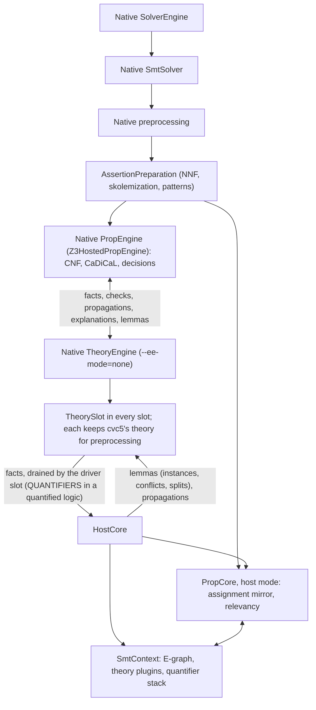
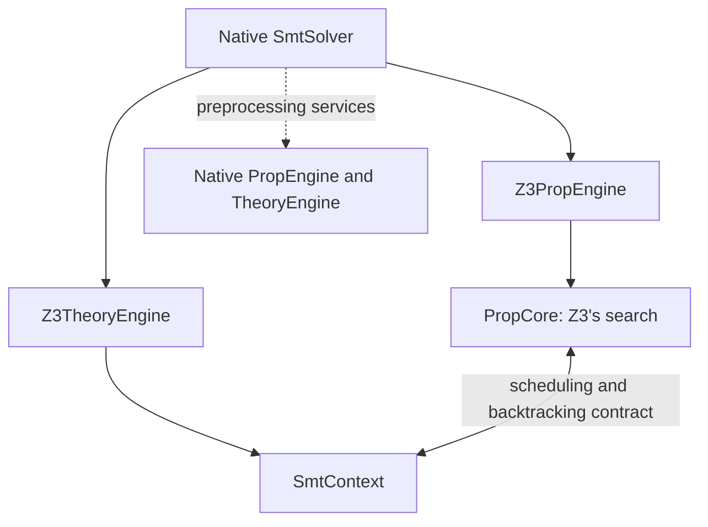
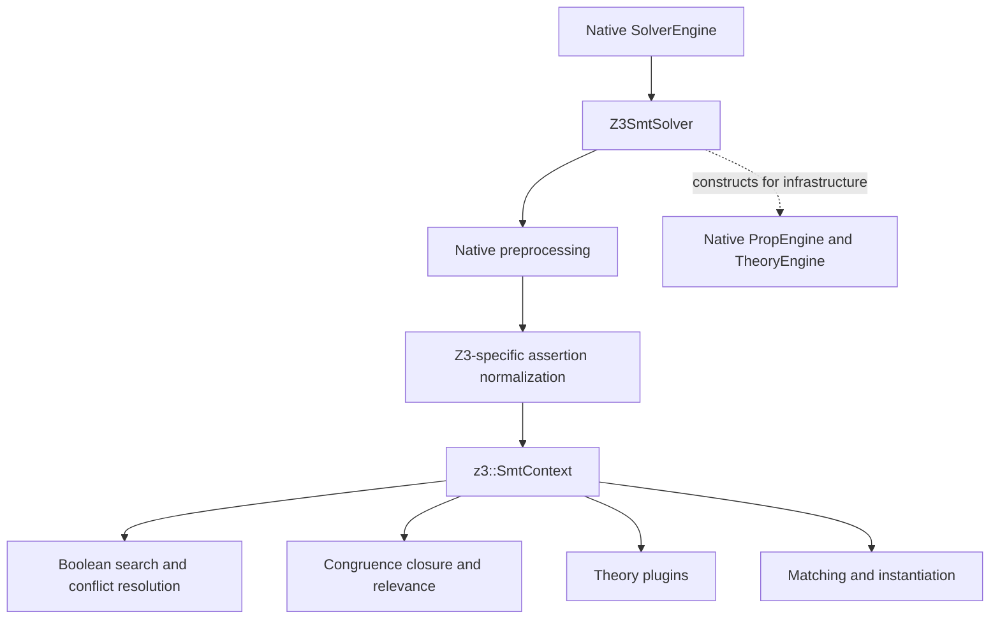
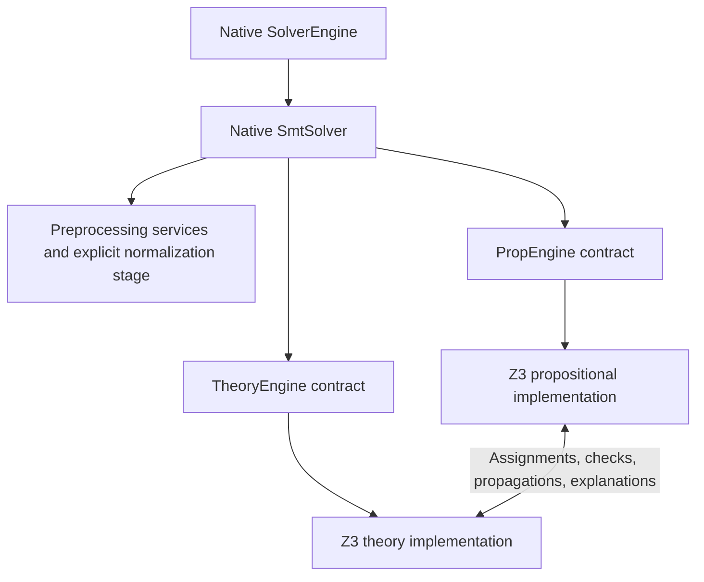
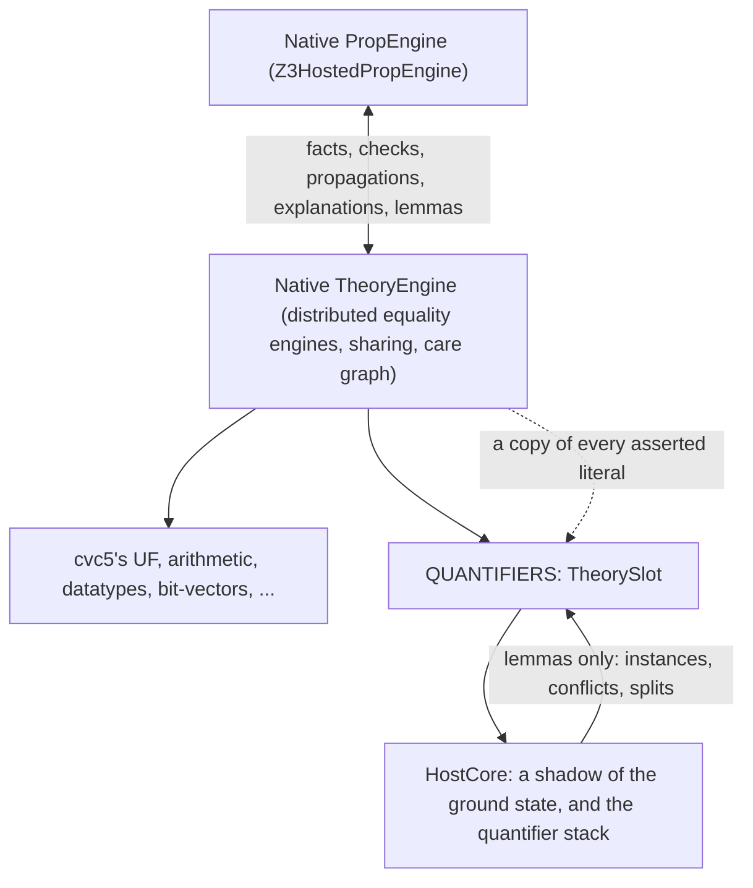

# Proposal: progressively align the Z3 port with cvc5's architecture

Date: 2026-10-10

Source snapshot: `da001fa639` (`Preset`)

Status: Stages 1A and 1B implemented. See the progress record in section
14. Stage 2 (section 15) is implemented as a hosted engine. Stage 3
(section 16) is implemented through step 4 and is the default configuration
of `--z3`; its first results came from a soundness bug, fixed, and its extra
unknowns from two bugs, fixed (section 16, Progress). Stage 4 (section 17),
cvc5's theories next to the port's components, starting with only the
quantifiers slot from the port, is under way: it runs
(`--z3-slots=quantifiers`), soundly as far as checked, and is weaker than
Stage 3 for now (section 17, Progress). Section 2 shows the current
architecture.

## 1. Objective and migration principle

The experiment began by reproducing a large portion of Z3's SMT core inside
cvc5 to investigate quantifier performance. The next objective is to retain
the useful performance while progressively returning control to cvc5's native
architecture.

The primary measure of progress should be the highest architectural layer
still replaced by Z3-specific machinery. Removing an alternative SMT driver
is an earlier milestone than replacing an individual arithmetic algorithm,
even if the latter would delete more source lines.

The governing rule is:

> Above the current replacement boundary, ordinary cvc5 code runs through
> ordinary cvc5 contracts. Backend selection is confined to construction and
> configuration. Z3-specific state and control flow stay below that boundary.

Apply this rule recursively. First restore native SMT orchestration over Z3
propositional and theory implementations. Then restore native propositional
and theory orchestration over smaller Z3 components. Continue until the
remaining imported mechanisms are localized algorithms or data structures
with a measured reason to remain.

Architectural alignment does not require deleting every algorithm that
originated in Z3. A useful matching algorithm inside cvc5's quantifier
architecture can be a successful endpoint. Retaining an alternate top-level
solver because that algorithm needs it is the dependency to eliminate.

Source size remains useful, but is a secondary measure. Early interface work
can increase the diff while reducing the scope of the architectural fork.

## 2. Current architecture

The relevant implementation is described in [README.md](README.md) and
[FIDELITY.md](FIDELITY.md). Those documents contain historical measurements
from different configurations and benchmark samples; this proposal does not
treat them as one reproducible performance baseline.

### Today (2026-10-15)

`--z3` has three configurations, one per stage reached, and a fourth under
way:

| Configuration | Options | Propositional search | Theory orchestration | Below it |
|---|---|---|---|---|
| **Stage 3, the default** (section 16) | `--z3` | cvc5's `PropEngine` (CNF, CaDiCaL, justification decisions) | cvc5's `TheoryEngine`, a `TheorySlot` in every slot, no equality engines | `HostCore` over the shared core |
| Stage 2, the hosted engine (section 15) | `--z3-theory-engine=z3` | cvc5's `PropEngine` | `Z3TheoryEngine`, overriding `TheoryEngine`'s search contract | `HostCore` over the shared core |
| Stage 1, the port's own search (section 14) | `--z3-prop-engine=z3` | `PropCore`, Z3's search | `Z3TheoryEngine` | the shared core |
| Stage 4, under way (section 17) | `--z3-slots=quantifiers` | cvc5's `PropEngine` | cvc5's `TheoryEngine`, with cvc5's theories and equality engines, and a `TheorySlot` in QUANTIFIERS | `HostCore` as a shadow of the ground state, for matching and instantiation |

The shared core is the `SharedBackend`: `SmtContext` (the E-graph, the
theory plugins, the quantifier stack) and `PropCore`. Under cvc5's prop
engine, `PropCore` runs in host mode. It mirrors cvc5's assignment for the
theory side and computes relevancy, and it does not search.

The default configuration:



The port's own search:



### At the start (2026-10-10)

The search path was:



Stage 1A removed `Z3SmtSolver`. In `SolverEngine::finishInit`, the `--z3`
option replaced the previously constructed `SmtSolver` with `Z3SmtSolver`.
The replacement also caused the SyGuS and quantifier-elimination solver
wrappers to be reconstructed around the new SMT solver.

`Z3SmtSolver` overrode initialization, assertion delivery, satisfiability
checking, push/pop, trail reset, interruption, and assertion reset. Its
initialization still called the native `SmtSolver::finishInit`, constructing
native propositional and theory engines for infrastructure. Actual search ran
in a separate `z3::SmtContext`.

This produced two architectural problems:

- SMT orchestration had an alternative implementation, so changes to native
  orchestration could bypass the experiment or need a separate
  implementation.
- Existing engine accessors exposed native engine objects even though the
  active search state belonged to the port. Each consumer had to be
  understood before those accessors could serve as a reliable abstraction
  boundary.

The port already used cvc5 `Node`, rewriting, and preprocessing. The task
was therefore to restore ownership and communication boundaries around
search, not to replace the term representation again.

## 3. The first milestone

Reached: Stages 1A and 1B (section 14).

The first target is a single native `SmtSolver`, using selectable
propositional and theory engine implementations:



`Z3PropEngine` and `Z3TheoryEngine` are descriptive names for the proposed
implementations. They do not yet exist, and this diagram does not prescribe
inheritance or final filenames.

The first milestone has two distinct stages.

### Stage 1A: restore native SMT orchestration

Remove `Z3SmtSolver` and run both configurations through native `SmtSolver`.
Introduce the engine contracts needed by its callers, with Z3 implementations
that may initially delegate to one shared `SmtContext`.

This is meaningful progress if native `SmtSolver` actually performs the
bookkeeping and lifecycle operations, and supported queries go to the active
backend. Moving the existing alternate driver wholesale behind one generic
`runZ3` method would not achieve that.

A shared backend is an explicitly temporary implementation technique. It
allows the surrounding architecture to change while preserving the existing
search loop, callback order, and data structures. Stage 1A does not establish
that the propositional and theory implementations can be exchanged
independently.

### Stage 1B: establish the propositional/theory boundary

Separate the responsibilities currently combined in `SmtContext`. Route the
interactions needed by search through explicit contracts, and give mutable
state a clear owner.

This completes the first architectural milestone. The criterion is that a
subsequent replacement of either implementation has a defined interface to
implement, without reaching through the other implementation to arbitrary
`SmtContext` internals. Independent replacement may still require additional
capabilities; those must be recorded rather than hidden behind a shared
context pointer.

Behavior preservation should guide both stages. Replacing arithmetic,
changing matching policy, or retuning heuristics belongs in later work unless
a specific interface defect makes a small prerequisite change necessary.

## 4. Responsibilities at the restored SMT boundary

The native [SmtSolver](../smt/smt_solver.cpp) already delegates search to
`PropEngine::checkSat` and assertions to `PropEngine::assertInputFormulas`.
The migration should reuse that orchestration while supplying suitable engine
implementations.

| Responsibility | Intended owner after Stage 1A | Requirement |
|---|---|---|
| Backend construction | Engine construction/configuration code | Select a compatible pair of engines; keep selection out of ordinary SMT operations. |
| Assertion management | Native `SmtSolver` and `Assertions` | Preserve assertion tracking, skolem metadata, and preprocessing soundness information. |
| Input transformation | Preprocessing services plus an explicit backend preparation stage | Preserve the formula and ordering currently received by the port. |
| Search | Propositional engine contract | Run the selected search implementation and return its result. |
| Theory status | Theory engine contract | Report incompleteness and soundness information from the active backend. |
| Push/pop and trail reset | Native orchestration invoking engine lifecycle contracts | Distinguish user scopes from search scopes; reset shared state once. |
| Interruption and resource limits | Common lifecycle contract with backend implementation | Interrupt the active search and preserve the reason for termination. |
| Value and state queries | Active engine contracts | Never use inactive native search state as a substitute. |
| Optional services | Explicitly supported backend capabilities | Architectural integration alone does not add model, proof, or other feature support. |

The current `Z3SmtSolver::checkSatInternal` translates Z3 search outcomes into
cvc5 `Result` values and unknown explanations. That translation belongs behind
the engine contract. Native `SmtSolver` should not need to understand Z3
failure enums.

Reusing native orchestration also exposes behavior that the override currently
bypasses. For example, native assertion delivery forwards preprocessing
soundness flags and maintains assertion/skolem bookkeeping. These obligations
must be checked explicitly; merely reaching the native methods does not show
that the backend consumes the information correctly.

## 5. Interface design and implementation approach

### Start from callers and existing contracts

[PropEngine](../prop/prop_engine.h) and
[TheoryEngine](../theory/theory_engine.h) are concrete classes with largely
non-virtual public operations. Adding subclasses alone would not redirect
calls made through the existing pointer types.

There are two plausible implementation approaches:

- Extract shared interfaces and have the existing native classes and new Z3
  classes implement them.
- Keep stable engine facades and delegate appropriate operations to a backend
  owned by each facade.

Prefer the smallest interface change that preserves native ownership and
serves actual callers. The initial dependency audit should determine which
approach causes less disruption. Do not duplicate the entire large engine API
before identifying which portions are search operations, preprocessing
services, and optional facilities.

The audit must include more than `SmtSolver`. Relevant consumers include
`SolverEngine`, `Preprocessor`, `PreprocessingPassContext`, and `Valuation`.
They currently store or retrieve concrete engine pointers. A method that is
only called during initialization can still prevent a clean substitution.

### Construct a compatible backend pair

During Stage 1A, construct the two Z3 engine views together with one explicit
owner of the shared backend. Keep ownership and destruction order local to
that implementation. `SmtSolver` can own generic engine interfaces without
owning a `z3::SmtContext` or a Z3 parameter object directly.

Do not expose arbitrary combinations of native and Z3 engines before their
contracts are compatible. A coupled Z3 pair is a valid intermediate state;
claiming independent interchangeability at that point would overstate the
result.

Avoid a generic interface that returns `SmtContext*` so callers can bypass
missing methods. Use explicit operations and record any temporary dependency
that remains below the boundary.

### Separate infrastructure from active search state

Native preprocessing currently depends on services supplied by native engine
objects. Those services need either independent ownership or deliberate
delegation through the new facades.

It is acceptable to retain a native service object for preprocessing while
performing Stage 1A. Its purpose and lifetime must be explicit. It must not
answer active valuation, assertion-level, model, or search-status queries.
The engine accessor contract must identify the active implementation for every
supported query.

## 6. Preserve preprocessing and lifecycle semantics

### Assertion preparation

`Z3SmtSolver::assertToInternal` currently performs additional work after
native preprocessing: NNF and quantifier naming, connective and bound-variable
normalization, optional rewriting and ITE lifting, and pattern inference.
Definitions introduced by quantifier naming are delivered before the formula
that caused them. Further normalization occurs when instances are
internalized.

Move this behavior into an explicit preparation stage, initially retaining
its exact transformations and order. A backend preparation hook is a possible
first implementation; integration as native preprocessing passes can follow
once the contracts are established.

There is an important placement constraint. Native `SmtSolver::preprocess`
documents an invariant about assertion ordering and introduction of new
assertions at its boundary, whereas the port's preparation can add
definitions. The implementation must account for assertion indices, the
skolem map, and the distinction between original assertions and generated
definitions. Moving the code to a different method without updating these
contracts is insufficient.

Preserve the existing treatment of Boolean terms and term ITEs while doing
this work. Trigger availability depends on these shapes. Do not accidentally
run two internalizers or apply native CNF conversion and the port's conversion
to the same assertion.

### Initialization and reset

Native `SmtSolver::resetAssertions` recreates its propositional engine while
retaining its theory engine. The port currently recreates `SmtContext`.
A pair of facades sharing that context therefore needs a coordinated reset
contract; neither facade may retain references to the old state.

Preserve the lifetime relationship between `Params` and `SmtContext`, and
audit initialization order. The existing fidelity notes document at least
one parameter whose effective value depends on when it is copied during
construction. Structural changes can alter search settings without changing
an option's declared default.

Distinguish the following operations in the lifecycle design:

- User push/pop of assertions.
- SAT decision-level push/backtrack during search.
- Restarts and resetting the search trail to the current assertion level.
- Repeated satisfiability checks, including assumptions where supported.
- Resetting all assertions and destroying/recreating backend state.

Each state structure needs one owner and one rollback policy. Delayed theory
scopes, instance caches, normalization caches, relevance state, and queued
propagations must be included in that accounting.

Presolve, postsolve, cancellation, and statistics registration must likewise
occur once at the appropriate layer. Native `PropEngine::checkSat` performs
lifecycle work beyond calling a SAT solver; wrapping it around an existing
complete search driver without reviewing those calls can duplicate work.

## 7. Establishing the propositional/theory boundary

The central difficulty in Stage 1B is that `SmtContext` combines Boolean
search, internalization, congruence closure, relevance, theory dispatch, and
quantifier scheduling. These responsibilities do not divide into two files
along cvc5's current boundary.

Use [TheoryProxy](../prop/theory_proxy.h) as an existing contract reference:
it already describes theory checks, literal delivery, propagation,
explanations, decision requests, restarts, and incompleteness. It is not
automatically a ready-made interface for the port; its concrete dependencies
and scheduling assumptions must be examined.

The split should account for these interactions:

| Interaction | Contract to establish |
|---|---|
| Term and atom registration | Which side creates Boolean literals and theory terms, and when registration can produce further work. |
| Assigned theory literals | Which assignments are delivered, in what order, and at what search scope. |
| Equality and disequality information | Who owns congruence closure and how interested theories and matching receive notifications. |
| Propagations | How new facts return to Boolean search, including their explanation and lifetime. |
| Conflicts and lemmas | How theory reasons become clauses and how auxiliary terms are registered. |
| Check scheduling | When propagation, theory checking, quantifier work, and final checking run and reach a fixed point. |
| Relevance and decisions | How relevance changes and requested case splits cross the boundary. |
| Backtracking and restarts | Which callbacks restore which state and invalidate which pending work. |
| Final status | How consistency, incompleteness, and model soundness determine the public result. |

Congruence closure naturally belongs with theory services in the target
decomposition, while Boolean assignments and conflict search belong with the
propositional implementation. Relevance and internalization require a more
careful allocation because both sides consume their effects. Their ownership
should be decided from dependencies, not from filenames.

Keep `ENode`, clause, and justification representations private below the
restored SMT boundary. At the prop/theory boundary, isolate any representations
that must initially be shared and document them as remaining dependencies.
Converting every low-level structure in the same change would make it harder
to identify the source of a regression.

## 8. Proposed implementation sequence

The first implementation effort should be a sequence of reviewable changes
with a stable reference executable throughout.

| Step | Deliverable | Completion evidence |
|---|---|---|
| 0. Record the baseline and contracts | Exact source/build/configuration/benchmark manifest; inventory of engine callers and current capabilities | Reference runs can be reproduced; each required operation has an identified owner. |
| 1. Introduce the chosen engine abstraction | Native implementations behind the selected interfaces or facades | The ordinary cvc5 configuration preserves behavior and performance. |
| 2. Extract assertion preparation | Explicit port-specific preparation stage with metadata handling | The formulas and order delivered to the port agree with the reference. |
| 3. Add the coupled Z3 engine pair | Shared backend encapsulated behind prop/theory contracts | The native SMT driver performs checking, scope operations, and supported queries through the new implementations. |
| 4. Remove `Z3SmtSolver` | Delete the alternate driver and its selection/reconstruction path | Stage 1A acceptance criteria pass; the shared backend remains documented. |
| 5. Separate prop/theory responsibilities | Explicit event, state ownership, and explanation contracts | Stage 1B acceptance criteria pass; remaining cross-component dependencies are enumerated. |

Steps may be combined when that makes a patch easier to understand. Keep
changes to search algorithms and heuristic defaults separate from these
structural changes. If restoring a native path reveals a correctness defect,
isolate its correction and explain its effect on the comparison rather than
preserving the defect to obtain identical traces.

## 9. Expected code changes and deletion accounting

The initial work mostly reorganizes the existing experiment. It does not
require importing another Z3 subsystem or replacing an individual theory.

| Area | Expected change |
|---|---|
| `src/smt/solver_engine.cpp` | Remove the alternative SMT-solver construction path; retain one native driver. |
| `src/smt/smt_solver.{h,cpp}` | Construct/select engine implementations through a common mechanism and retain native orchestration. |
| `src/smt/z3_smt_solver.{h,cpp}` | Delete after moving necessary preparation and backend behavior to their proper owners. |
| `src/prop/prop_engine.{h,cpp}` and `src/theory/theory_engine.{h,cpp}` | Establish engine contracts or backend delegation with a working native implementation. |
| New Z3 prop/theory integration files | Implement the selected contracts and initially encapsulate the shared context. |
| `src/smt/preprocessor.*` and `src/preprocessing/preprocessing_pass_context.*` | Adapt engine dependencies and host explicit preparation where appropriate. |
| `src/theory/valuation.*` and other engine consumers | Ensure state queries use active engine contracts; exact edits depend on the interface approach. |
| `src/prop/theory_proxy.*` and `src/z3/smt_context.*` | Establish the internal prop/theory interaction during Stage 1B. |
| `src/CMakeLists.txt`, options, and experimental documentation | Update sources, backend construction/configuration, and the documented architecture. |

At the source snapshot recorded above:

- `z3_smt_solver.h` contains 73 lines and `z3_smt_solver.cpp` contains 163:
  236 lines in the wrapper proposed for removal.
- `src/z3` contains 96 C++ source/header/include-fragment files and 42,417
  physical lines, including comments, blank lines, and original adapter code.

The 236 wrapper lines are a gross removal figure, not an expected net saving.
Necessary behavior moves into other components, and interfaces add code.
Stage 1A may have a positive net diff. No substantial deletion of the
42,417-line implementation should be credited merely because it becomes
private to new facades or moves to another directory.

Keep separate counts for imported code removed, code moved, new integration
code, and native code modified. Preserve provenance notices on retained or
moved imported implementations. Detailed estimates for later component
deletions should follow the architecture split, when their dependency closure
can be measured accurately.

## 10. Acceptance criteria and measurement

### Architectural acceptance

Stage 1A is complete when:

1. There is one native `SmtSolver` implementation in the active paths, with no
   `Z3SmtSolver` subclass or equivalent alternate driver.
2. Backend-specific selection is localized to construction/configuration;
   normal SMT operations do not branch on Z3-specific search behavior.
3. Assertion bookkeeping, result handling, and lifecycle dispatch use the
   native orchestration and explicit engine contracts.
4. Supported engine queries return information from the active backend.
   Unsupported facilities have an explicit capability boundary, rather than
   silently querying inactive native state.
5. Shared backend ownership and any retained preprocessing-only services are
   documented, with coordinated initialization and reset.

Stage 1B additionally requires identifiable owners for Boolean and theory
state, explicit interactions between them, and no unrestricted shared-context
access that bypasses the intended boundary. Any remaining representation or
scheduling dependency is listed as work for the next level.

### Correctness and lifecycle validation

Compare the reference and candidate on the supported input/configuration
scope. Exercise single checks, repeated checks, user push/pop, assertion
reset, interruption, resource exhaustion, and assumptions where supported.
Include cases that require theory propagation, nested quantifier
instantiation, and rollback after generated lemmas.

Verify the public result and relevant unknown/incompleteness reason. A backend
that currently cannot confirm quantified satisfiability must not start
returning `sat` because its incompleteness information was lost in an adapter.
Likewise, forwarding through native interfaces does not establish support for
proofs, models, unsat cores, SyGuS, or quantifier elimination. Existing
capabilities and limitations need an explicit inventory.

Run relevant native regressions as well, because introducing engine
abstractions affects the ordinary configuration. Cross-solver agreement is
useful regression evidence, but does not by itself prove soundness.

### Performance validation

Freeze a benchmark manifest, compiler/build settings, machine conditions,
timeouts, seeds, and the complete option set. Use the pre-change port as the
primary control for architectural refactoring. Keep native cvc5 with
`--user-pat=strict --no-cbqi` and appropriately configured Z3 as contextual
references. Treat `verus` and `verus-best` as separate configurations.

Track per-benchmark outcomes, common-solved runtimes, memory, timeouts, and
important search counters. Interleave reference/candidate runs and repeat
borderline or noisy cases. Maintain a held-out set and expand beyond the
small diagnostic sample before declaring a milestone complete.

For a structural change, expect search counters and normalized inputs to
remain close, and often identical on deterministic cases. Investigate
differences using the existing assertion, instance, and event diagnostics.
Exact trace equality is a diagnostic aid, not a requirement for every future
architectural substitution.

A completed step should have no unresolved answer changes or material
performance regressions beyond the measured run-to-run variation. Record
individual losses as well as aggregate gains. If there is an intentional
tradeoff, report it explicitly rather than counting the architectural step as
performance-preserving.

## 11. Main risks and how to contain them

| Risk | Consequence | Containment |
|---|---|---|
| Facades preserve hidden SMT orchestration | The class disappears but the high-level fork remains | Review responsibility ownership, not just class names and includes. |
| Queries reach an inactive native engine | Incorrect assignments, assertion levels, or status information | Audit all engine consumers and test active-state queries. |
| Shared context reset or rollback happens twice | Stale references or inconsistent scopes | One backend owner and explicit lifecycle coordination. |
| Preprocessing or registration order changes | Different terms, literals, relevance, and trigger availability | Compare prepared assertions and registration/event traces. |
| Theory information is delivered later | Matching misses productive search states or explores more branches | Preserve callback scheduling before replacing algorithms. |
| Explanations outlive their scope | Invalid propagated facts or conflicts | Specify reason ownership and rollback semantics at the interface. |
| Initialization timing changes effective parameters | Performance changes despite identical options | Record effective configuration and preserve initialization order. |
| Interface abstraction is too broad or costly | Large native churn or hot-path overhead | Separate cold orchestration from hot callbacks; measure native and port configurations. |
| A local metric hides remaining coupling | Apparent progress without an independently replaceable component | Report the highest replacement layer and remaining dependencies for each branch of the architecture. |

## 12. Continuing recursively

After the first milestone, proceed down the two branches of the architecture.
The hierarchy supplies the ordering constraint; it does not force an arbitrary
order between sibling components.

| Architectural level | Replacement to retire | Possible lower-level remainder |
|---|---|---|
| SMT orchestration | `Z3SmtSolver` | Z3 prop/theory engine implementations |
| Propositional orchestration | Z3 prop-engine implementation | Z3 SAT/search, decision, or internalization components behind native orchestration |
| Theory orchestration | Z3 theory-engine implementation | Individual theory, equality, and quantifier implementations |
| Individual solver modules | Z3-specific theory or quantifier module | Local algorithms and data structures with measured value |
| Local mechanisms | Remaining duplication where native alternatives suffice | Small, justified residual implementation |

The existing [SAT solver interfaces](../prop/sat_solver.h) provide a candidate
boundary for the propositional branch. Using them will also require resolving
CNF/internalization, relevance, and theory-callback assumptions; the whole
current `SmtContext` is not automatically a SAT solver implementation.

For the theory branch, restoring native `TheoryEngine` would make individual
ported theories and quantifier components the next explicit dependencies.
Replacing arithmetic can then be evaluated at the restored theory interface,
as one child of the architecture, rather than becoming the organizing goal of
the migration.

Maintain a progress record with the highest remaining replacement on each
branch, the native layers restored, the dependencies that still cross the
intended boundaries, the source accounting, and the performance comparison.
Two branches can be at different depths; a single line count or stage number
would obscure that information.

## 13. Decisions for the first implementation

The proposed direction is to restore native `SmtSolver` over
engine contracts, then separate the port's prop/theory responsibilities.
Several implementation choices remain to be resolved by a focused audit:

- Whether shared interfaces or stable facades minimize changes to native
  callers while keeping responsibilities clear.
- Which native engine services preprocessing requires independently of active
  search, and how to provide them without exposing inactive search state.
- Where backend assertion preparation belongs and how generated definitions
  and skolem metadata are represented at that boundary.
- How a coupled backend is owned and reset while native orchestration remains
  common to both configurations.
- Which exact operations and optional capabilities must be supported to
  preserve the current experimental scope.

The concrete next implementation deliverable is Stage 1A: a native
`SmtSolver` running the existing port through explicit prop/theory engine
contracts, with a reproducible behavior and performance comparison. The
shared `SmtContext` at that stage should be visible in the design and progress
record. Stage 1B then turns that integration boundary into an internal
architectural separation suitable for the next recursive replacements.

## 14. Progress record

### Stage 1A: done

Implemented in `8a1ca4ad2c`, followed by the capability changes described
below.

| Branch | Highest Z3-specific layer remaining | Notes |
|---|---|---|
| SMT orchestration | none | `Z3SmtSolver` is deleted; native `SmtSolver` drives both configurations. |
| Propositional | `z3::Z3PropEngine`, a whole engine | Implements `PropEngine`'s search contract over the shared `SmtContext`. |
| Theory | `z3::Z3TheoryEngine`, a whole engine | Owns the shared backend. Its inherited `TheoryEngine` serves preprocessing only. |

Native layers restored:

- `SmtSolver` performs assertion bookkeeping, forwards preprocessing
  soundness flags, constructs the engines and dispatches the lifecycle for
  both configurations. `smt_solver.h` is identical to master.
- `SolverEngine` contains no reference to `--z3`. Commands that need an
  optional feature ask the engine through `PropEngine::supports`.
- Backend selection happens only in construction (`smt::EngineFactory`) and
  configuration (`SetDefaults::checkZ3Capabilities`).

Contracts introduced:

- The search contract of `PropEngine`, whose methods are now virtual:
  `finishInit`, `assertInputFormulas`, `checkSat`, `push`, `pop`,
  `resetTrail`, `getAssertionLevel`, `interrupt` and `supports`. None of
  these is called on the hot path of the search.
- `prop::SearchFeature`, the capability query for user scopes, assumptions,
  and participation of cvc5's quantifiers engine.
- A virtual destructor on `TheoryEngine`.

Dependencies that still cross the intended boundaries:

- `Z3PropEngine` and `Z3TheoryEngine` share one `SmtContext` through
  `z3::SharedBackend`, which `Z3TheoryEngine` owns. `EngineFactory` pairs the
  two engines with a cast that is checked only in debug builds.
- `Z3PropEngine` reads the preprocessing soundness flags from its paired
  theory engine.
- Both Z3 engines inherit the native engines. The inherited SAT solver, CNF
  stream and theories are constructed but inactive. Their non-contract
  queries can only be reached through refused features: options are refused
  in `checkZ3Capabilities`, and commands through `supports`.
- Assertion preparation (`z3::AssertionPreparation`) runs inside
  `Z3PropEngine::assertInputFormulas`. It uses utilities owned by the
  `SmtContext`, because instance internalization uses the same utilities.
- The translation of unknown reasons is preserved from the old driver, so a
  time limit is reported as `INTERRUPTED` rather than `TIMEOUT`.

Behavior changes, all intended:

- The preprocessing soundness flags now take effect. Only `int-to-bv` and
  `solve-real-as-int` set them.
- The exception paths in `SmtDriver` now reset the trail of the active
  search. Previously they reset the trail of the inactive native engine.
- The following are now refused, because each one read inactive native
  state: `--deep-restart`, `--dump-instantiations`, which previously printed
  "none" after the port had instantiated, `--oracles`, `declare-pool`, and
  the API's instantiation queries.
- The messages for refused commands changed from "not supported with --z3"
  to "not supported by the selected search engine".

Source accounting, in physical lines of C++ files under `src/z3`:

- At `da001fa639`: 96 files, 42,417 lines. Immediately before Stage 1A
  (`75c37b9f3b`): 96 files, 42,144 lines.
- After Stage 1A: 104 files, 42,732 lines. The imported implementation is
  unchanged; the difference is 588 lines of new integration code in
  `z3_prop_engine`, `z3_theory_engine`, `shared_backend` and
  `assertion_preparation`.
- Removed: `src/smt/z3_smt_solver.{h,cpp}`, 236 lines. Its assertion
  preparation and result translation, about 85 lines, moved into the new
  files.
- Added outside `src/z3`: `src/smt/engine_factory.{h,cpp}`, 105 lines.
- Native code modified: `prop_engine.{h,cpp}`, `theory_engine.h`,
  `smt_solver.{h,cpp}` (restored to master apart from engine construction),
  `solver_engine.{h,cpp}` and `set_defaults.cpp`, roughly 110 lines added and
  60 removed.

Performance and behavior:

- Local comparison against the build from before the change: 444 quantified
  regressions, each run under the default and `verus-best` presets with a
  10 s limit. In 873 of the 888 runs the answers and every `z3::` search
  counter were identical; the other 15 timed out in both builds. Runs
  limited by `--rlimit` stopped at the same point with identical counters.
- The benchmark comparison on the reference set showed no regression.

### Stage 1B: done

The audit of `SmtContext` that section 7 calls for is recorded in
[PROP_THEORY_SPLIT.md](PROP_THEORY_SPLIT.md). It allocates relevancy to the
propositional side, splits internalization as cvc5 splits CNF conversion from
pre-registration, and proposes seven extraction steps that preserve
behavior. All seven are done, each checked as in Stage 1A (identical
answers and `z3::` counters on the local comparison set, with runs that
time out compared under `--rlimit`):

1. Dead paths removed: 239 lines of imported code that nothing reached,
   listed in FIDELITY.md.
2. `z3::Explainer` extracted from `ConflictResolution`. The first-UIP
   resolution no longer reads the E-graph.
3. `z3::TheoryStatus` extracted. It holds the unsupported and model-unsound
   records that decide whether "sat" can be confirmed.
4. (a) `z3::PropCore` extracted: the Boolean search state and the methods on
   it, about 1,500 lines moved unchanged out of `smt_context.cpp` and
   `internalizer.cpp`. The search driver, conflict resolution and the
   sequencing of scopes remain in `SmtContext` until step 4(b). On a small
   timing sample with identical work, the run time was unchanged (ratio
   0.996).

   (b) The search driver moved into `PropCore` as well: search, restarts,
   decisions, the propagation fixpoint, conflict resolution and the push
   and pop of scopes. `SmtContext` is now the theory side. Apart from its
   entry points (`check`, `push`, `pop`, the input queue), the driver
   reaches it only through the scheduling and backtracking contract listed
   in `PropCore`'s class comment and in PROP_THEORY_SPLIT.md. Answers and
   `z3::` counters are unchanged, and runs that time out match under
   `--rlimit`. On the same small timing sample the ratio was 0.951, which is
   within the noise.
5. Relevancy is owned by `PropCore`. The theory side keeps only the part of
   the relevancy notification that reaches the quantifier manager and the
   theories, and gives the propagator the members of an equivalence class.
6. Internalization is split as cvc5 splits CNF conversion from
   pre-registration. `PropCore` encodes gates and root assertions. The
   theory side walks the input, makes enodes and theory atoms, and calls it
   at the same points as before. Theory plugins register an atom with one
   call.
7. Ownership is wired. `Z3PropEngine` drives `PropCore`, which now also
   holds the entry points (check, user scopes) and the asserted formulas.
   `SmtContext` has no entry points and is driven only through its contract
   with `PropCore`. The two are still allocated together, inside
   `SharedBackend`.

Every step left answers and `z3::` counters unchanged on the comparison
set, and runs that time out were compared under `--rlimit`. On the
benchmark set, performance was unchanged after each step that was
measured.

| Branch | Highest Z3-specific layer remaining | Notes |
|---|---|---|
| SMT orchestration | none | Native `SmtSolver` for both configurations. |
| Propositional | `z3::Z3PropEngine` over `z3::PropCore` | `PropCore` holds Z3's Boolean search: variables, clauses, BCP, conflict resolution, decisions, restarts, relevancy, the encoding of gates, and the search driver. |
| Theory | `z3::Z3TheoryEngine` over `z3::SmtContext` | `SmtContext` holds Z3's theory reasoning: the E-graph, the theory plugins, quantifiers and E-matching, the internalizing walk, the explainer and the theory status. |

Dependencies that still cross the boundary, as work for the next level:

1. **Allocation.** `PropCore` lives inside `SmtContext`, so that the
   theory side's Boolean queries (`getAssignment`, `isRelevant` and others,
   called on the hot paths of E-matching and the theories) are inline
   forwarders. Replacing either side independently requires turning that
   Boolean API into an interface, at the cost of an indirection.
2. **Propositional components still hold the theory-side handle.**
   `ConflictResolution` and `CaseSplitQueue` take `SmtContext&` and make
   their Boolean queries through its forwarders. `ConflictResolution` also
   calls `Theory::conflictResolutionEh`, and the case split queue can ask
   `isExtDiseq` (off by default). Both could take `PropCore&` instead.
3. **Shared infrastructure on the theory side.** The trail stack, the
   region, the statistics, the random number generator and the store of
   justifications belong to `SmtContext` and are used by both sides. The
   trail is one LIFO log for both, as `context::Context` is in cvc5.
4. **Variable data.** `BoolVarData` holds the Boolean data together with
   the theory side's atom-kind flags (enode, equality, quantifier,
   theory-notified). `PropCore` reads them to decide which assignments to
   hand over and which to requeue when they become relevant.
5. **The variable map.** The map between Boolean variables and Nodes is
   `PropCore`'s, but the theory side uses it throughout: the internalizer,
   the theories and E-matching.
6. **The internalizing walk.** The walk decides what is a gate and what is
   an atom, and stays on the theory side. `assertRoot` calls back into it for
   the arguments of a root gate.
7. **Clauses from the theory side during the search.** Instances, theory
   axioms, dynamic Ackermann lemmas and E-graph propagations reach
   `PropCore`'s clause API with region-allocated justifications.
   `PropCore` explains these through the theory side's `Explainer`.
8. **Generations across backjumps.** The generations of enodes and
   quantifiers are cached by the theory side when `PropCore` backjumps, and
   restored when it recreates atoms.
9. **Relevancy and equivalence classes.** The relevancy propagator reads the
   theory side's equivalence classes, and `relevantEh` is split between the
   two sides.
10. **Theory plugins.** Plugins register atoms with `mkTheoryAtomVar`, but
    still read and assign the Boolean state through the forwarders, as
    cvc5's theories do through `Valuation` and the output channel.
11. **Defects.** The defects listed in PROP_THEORY_SPLIT.md, section 9, are
    not fixed; each is to be fixed in a change of its own.

The next level is the recursion of section 12, on the two branches:

- The propositional branch can now be addressed at `PropCore`, for example
  behind cvc5's SAT solver interfaces.
- The theory branch can be addressed at `SmtContext`, toward native
  `TheoryEngine` with ported theories.

With the boundary in place, a component on either side can be replaced on
its own, and the effect on performance attributed to it.

### Next: the propositional branch

[PROPOSITIONAL_BRANCH.md](PROPOSITIONAL_BRANCH.md) maps `PropCore` onto
cvc5's propositional engine: `PropEngine`, `TheoryProxy`, `CnfStream`, the
CDCL(T) solvers and the decision engine.

The architectural issues it identifies:

- **Instance lifetime.** Quantifier instances, and theory axioms, are
  scope-local in Z3 and permanent lemmas in cvc5.
- **Atom lifetime.** Atoms are scope-local in Z3, and need the
  re-internalization machinery; they persist in cvc5.
- **Relevancy.** Z3's relevancy decides what reaches the theories, what
  E-matching considers, and, under the Verus presets, what is decided. cvc5
  has no counterpart at the SAT level.
- **Instantiation timing.** Instances are made during propagation in Z3,
  and only at full or last-call effort in cvc5.
- **Decisions.** The relevancy case split queue against cvc5's
  justification heuristic.
- **Explanations.** Eager in Z3 and lazy in cvc5. This one is mechanical,
  but needed for hosting.

The next steps it proposes, in order:

1. Measure the switches the port already has, one at a time against the
   Verus presets. No code is needed: decisions, relevancy, phase, restarts,
   delayed units and the timing of instantiation.
2. Add switches that are off by default to separate the three roles of
   relevancy, to make instances permanent, and to try a justification-style
   decision queue and a MiniSat-style restart and GC policy. These are
   implemented; the runs to make with them are listed in
   PROPOSITIONAL_BRANCH.md, section 3.
3. Run cvc5's `PropEngine` over the port's theory side through a
   `TheoryProxy` adapter. This is the next architectural level on this
   branch. It requires resolving atom lifetime, implementing lazy
   explanations, and removing Stage 1B dependencies 1–5.

The measurements come first. If none of the propositional components
accounts for much of the difference, the theory branch is the one to audit
next.

### Next: the theory branch

The measurements of the propositional branch point at the theory side:
relevancy matters only through E-matching and the instance checker, and
instantiating during propagation matters; a Z3-style relevancy filter for
cvc5's own E-matching did not help. [THEORY_BRANCH.md](THEORY_BRANCH.md)
maps the theory side and the quantifier stack onto cvc5. Its main issues
are:

- **Matching:** eager, incremental matching after every propagation,
  against cvc5's rounds from scratch at full effort.
- **The instance queue:** under Verus it caps the depth of instantiation
  chains at about 100, which breaks matching loops; cvc5 has no cap by
  default.
- **Multi-patterns** are matched lazily, at final check only.
- **The instance checker** looks only at relevant terms.
- **The cvc5 bridge** runs at every final check under `verus-best`,
  which nothing so far has measured.

It proposes measurements with existing switches, a few switches that need
code, and the extraction of the quantifier stack behind an explicit
contract, as Stage 1B did for `PropCore`.

## 15. Stage 2: cvc5's propositional engine over the port's theory engine

### Goal

Run the port's theory side, `Z3TheoryEngine` over `SmtContext`, under
cvc5's own `PropEngine`: `CnfStream`, the CDCL(T) solver (CaDiCaL by
default), `TheoryProxy` and the decision engine. `PropCore` stays available
as an alternative propositional side over the same theory side, chosen in
`EngineFactory`, until measurements show it can go. The switches added for
the experiments stay too, so that each carried-over component can still be
turned off and its effect measured.

This is the propositional half of the next level of section 12: native
propositional orchestration over the port's theory engine.

### Why the evidence supports it

The experiments of PROPOSITIONAL_BRANCH.md and THEORY_BRANCH.md show that
the components cvc5's prop engine would replace do not carry the port's
performance:

- **Decisions:** activity loses, but justification order is as good as
  the relevancy queue, with or without relevancy gating what reaches the
  theories (B3a, B3c). cvc5 uses the justification heuristic for
  quantified logics.
- **Restarts, phase and delayed units** make no difference (A3–A5).
- **Delivery to the theories** need not be filtered by relevancy (B1a).

What does carry it must be carried across, and cvc5 has a place for most
of it:

| Component | Evidence | Where it goes under cvc5's prop engine |
|---|---|---|
| Eager matching and instantiation after every propagation | A6, A6b | cvc5 checks theories at standard effort after each propagation fixpoint (CaDiCaL's `cb_propagate`). The theory side's `theoryPropagate`, matching included, runs there; instances leave as lemmas. |
| Relevancy, for matching and the instance checker | B1f, B1g, q1 | A module between the SAT solver and the theory side. It needs the Boolean structure of the roots and the assignments of gate literals, which cvc5 does not report to theories. This is the main design question (below). |
| Scope-local atoms | (mechanism) | cvc5 re-registers, after a backtrack, the SAT literals registered above the backtrack level (`TheoryPreregistrar::notifyBacktrack`). This plays the role of the port's re-internalization; the generation cache stays with the theory side. |
| Explanations | (mechanism) | CaDiCaL asks for reasons lazily (`cb_add_reason_clause_lit`). The `Explainer` must answer for a single propagated literal on demand. |
| Instance lifetime | B2a, confounded | See the next subsection. |

### Instance lifetime and `--inst-local`

In Z3, an instance is a clause of the scope it is made in. Backtracking
past that scope removes it from three places at once:

1. the clause database;
2. relevancy: the instance is no longer a root, so the terms of its body
   stop being matching candidates;
3. the decision heuristic, which follows relevancy.

cvc5 has no clauses that disappear on backtracking. Its `--inst-local`
(off by default) simulates the third effect only. E-matching and
conflict-based instances are sent with `LemmaProperty::LOCAL`.
`PropEngine` then adds the clause to the SAT solver once per user context,
and tells the decision engine about it as a *local* assertion, which is
SAT-context dependent. `Instantiate` records local instances in a
SAT-context dependent trie, so an instance found again after a backjump is
sent again, and the justification heuristic sees it again. The clause
itself stays.

Stage 2 needs the second effect as well, since relevancy for matching is
what matters. The direction this suggests is to rethink `LOCAL` as a
general *scoped root* property: a lemma that is permanent in the SAT
solver, but a root for the decision engine *and the relevancy module* only
in the SAT context where it was last sent. Whether the clause should also
leave the SAT solver depends on whether permanent clauses hurt, which is
what step 0 measures.

### Steps

Steps 1 to 5 are refactorings inside the port, each leaving answers and
`z3::` counters unchanged as in Stage 1B. Step 6 is the new configuration.

0. **Measure instance lifetime without the relevancy confound.** In the
   port, make an instance's clause permanent but its relevancy scoped: its
   root is marked relevant in the scope where it is made, as a scoped
   instance's is, and again whenever matching finds it again. This is the
   port's counterpart of cvc5 with `--inst-local` plus relevancy. If it
   loses against the baseline, permanence itself hurts, and Stage 2 needs
   removable instances in cvc5's SAT solver.
1. **Give the theory side a Boolean interface.** Its Boolean queries and
   updates (assignment, internalized literals, relevancy queries, assigning
   and propagating literals) go through an interface that `PropCore`
   implements, instead of inline forwarders. `ConflictResolution` and
   `CaseSplitQueue` take `PropCore` instead of `SmtContext`. This resolves
   dependencies 1, 2 and 10 of section 14; measure the cost of the
   indirection.
2. **Route the theory side's clauses through an output interface.**
   Instances, theory axioms, dynamic Ackermann lemmas and E-graph
   propagations become calls on an interface (dependency 7), so that under
   cvc5 they can be lemmas and propagations of `TheoryProxy`.
3. **Explain one literal on demand.** The `Explainer` gives the
   explanation of a single theory-propagated literal as a clause, which is
   what `TheoryProxy::explainPropagation` needs.
4. **Make relevancy a standalone module.** Its inputs are the roots (input
   formulas and instances, with the scoped-root property of the previous
   subsection), the gate structure, and literal assignments; its outputs are
   the relevance events the theory side receives today (dependency 9).
5. **Let the host drive atom lifetime.** The theory side re-internalizes an
   atom when the host re-registers it, rather than through `PropCore`'s
   `reinitClauses`; the generation cache follows (dependency 8).
6. **The adapter.** A mode of `Z3TheoryEngine` that implements the calls
   cvc5's prop engine makes: pre-registration, asserted literals, standard
   and full checks, propagations, explanations and lemmas. `EngineFactory`
   chooses between `PropCore` and cvc5's prop engine over the same theory
   side. Measure it against `verus-best`, then retire the switches that made
   no difference.

### Open design questions

- **Relevancy's view of the Boolean structure.** `CnfStream` gives gates
  Tseitin variables that are not reported to theories. The relevancy module
  needs their assignments. Options:
  - a `TheoryProxy` hook reporting the assignments of the formula literals
    of registered roots;
  - observing the gate variables in the SAT solver (CaDiCaL's observed
    variables);
  - computing gate values from atom values, as the `RelevanceManager` does,
    but incrementally.
- **Formulas in term positions.** The port gives such a formula an enode
  merged with true or false; cvc5 purifies Boolean terms during
  preprocessing. The theory side must accept the purified form.
- **Lemmas during propagation.** Instances are made at standard effort,
  often many per propagation; the cost of sending them through
  `TheoryProxy` and `CnfStream` is unmeasured.

### Progress

- **Step 0: implemented, to be measured.** `--z3-qi-permanent-local`, with
  `--z3-qi-permanent`: the instance's clause is a permanent theory lemma,
  but the instance is a root, for relevancy and the case split queue, only
  in the scope where it is made and again whenever matching finds it again
  (`PropCore::reactivatePermanentRoot`); reinitializing its clause does not
  mark its literals relevant. On a sample its relevancy work matches the
  baseline's, where B2a's was inflated. With assertions on, it gives no
  wrong answers on the quantified regressions.
- **Step 1, first part: done.** `ConflictResolution` and `CaseSplitQueue`
  take `PropCore` instead of `SmtContext` (dependency 2 of section 14). The
  two things they needed from the theory side are now part of its contract:
  `SmtContext::conflictResolutionEh`, which calls the theory of the atom,
  and `SmtContext::isExtDiseqAtom`, for the disequality lookahead of the
  relevancy case split queue. The random number generator stays shared
  through `PropCore::getRandomValue`, so the sequence of random values is
  unchanged. Twenty-five forwarders of `SmtContext` that had no other
  callers are removed. Answers and `z3::` counters are unchanged on the
  comparison set.
- **Step 1, second part: proposed design.** What the theory side still
  needs from the Boolean side falls into four groups (call sites in the
  theory side, its plugins and the quantifier stack):

  | Group | Methods | Hot? | Under cvc5's prop engine |
  |---|---|---|---|
  | Queries | `getAssignment` (46 call sites), `bInternalized`, `getLiteral`, `getBoolVar`, `boolVar2Expr`, the atom flags in `BoolVarData`, `inconsistent`, scope levels | yes: E-matching, the checker, propagation | the SAT values of registered atoms; the conflict flag; the SAT context level |
  | Updates | `assign` with a justification, `setConflict`, `mkClause`, `mkBoolVar`, `setTrueFirstFlag`, `forcePhase` | less | a theory propagation (explained lazily), a conflict, a lemma, `ensureLiteral`, `preferPhase` |
  | Relevancy | `relevancy`, `isRelevant`, `markAsRelevant`, relevancy handlers and watches | yes | the relevancy module (step 4) |
  | Infrastructure | cancellation, resource limits, the region, the trail | mixed | cvc5's resource manager and contexts |

  Turning every forwarder into a virtual call would put an indirect call
  on the hottest paths of E-matching. The proposed shape avoids that:
  - **Queries read shared data.** The assignment and the per-variable data
    are arrays that the Boolean side keeps up to date and the theory side
    reads inline, as now. `PropCore` owns them today; under cvc5 the
    adapter would mirror the values of registered atoms into them as
    literals are asserted and backtracked.
  - **Updates go through an abstract interface** that `PropCore`
    implements, and later the adapter.
  - **Relevancy** keeps its own interface, which step 4 makes into the
    module.
- **Step 0 result: B2c is slightly worse than the baseline.** Permanent
  instance clauses cost a little. Removing clauses from cvc5's SAT solver
  is deferred: it is difficult and not majorly important.

### The shortest path to a baseline: `PropCore` as a mirror

To get a measurable baseline of cvc5's prop engine over the port's theory
engine quickly, steps 1 (second part) to 5 are deferred, and `PropCore`
runs as a **mirror** under cvc5's search instead of being replaced:

- **cvc5 searches:** `CnfStream`, the SAT solver, `TheoryProxy` and the
  justification heuristic decide, propagate, learn and restart.
- **`PropCore` mirrors** the assignment of the atoms cvc5 asserts, keeps
  its own encoding of the input's gates and its relevancy (which the
  measurements say must stay), and runs the theory side's propagation,
  eager matching included, at each check. It never decides, and never
  resolves a conflict itself.
- **Back to cvc5** go theory propagations (explained on demand by
  expanding justifications down to the literals cvc5 asserted, as conflict
  resolution does), conflicts (as conflict clauses), and new clauses
  (instances, theory axioms, dynamic Ackermann lemmas) as lemmas.
- **Scopes** follow cvc5's SAT context: `PropCore` pushes a scope per level
  when cvc5 asserts at a deeper level, and pops when the context pops
  (a post-pop `ContextNotifyObj`). An atom cvc5 asserts that the theory side
  does not have, for instance after it was deleted on backtracking, is
  internalized on demand, which stands in for re-registration (step 5).

The pieces:

- `TheoryEngine` makes virtual the dozen methods cvc5's prop layer calls
  (`preRegister`, `assertFact`, `check`, `getPropagatedLiterals`,
  `getExplanation`, `needCheck`, `getNextDecisionRequest`, `presolve`,
  `postsolve`, `notifyRestart`); behavior is unchanged for the native
  engine.
- `Z3TheoryEngine` implements them when `--z3-prop-engine=cvc5` (the
  default, `z3`, keeps `Z3PropEngine` over `PropCore`).
- `Z3HostedPropEngine`, a thin subclass of cvc5's `PropEngine`, prepares the
  input with `AssertionPreparation` and hands the prepared formulas both to
  `PropCore`, for its gates and relevancy, and to cvc5's CNF conversion.
- `PropCore` gets a host mode: assigning external literals, explaining a
  literal or a conflict in terms of them, and collecting the clauses the
  theory side creates.

Known simplifications of this first version: the skolem map of term
formula removal is not passed on (skolem definitions are ordinary
assertions for the decision heuristic); explanations omit literals of the
base level, which are permanent, so they are valid modulo the input; and
the gate clauses the theory side creates during the search for its own
formulas (term ITEs, for instance) are not sent to cvc5, which learns them
through propagations and conflicts instead.

### Progress: the mirror

`--z3 --z3-prop-engine=cvc5` is implemented as described above:
`TheoryEngine`'s prop-facing methods are virtual, `Z3TheoryEngine`
implements them in hosted mode, `Z3HostedPropEngine` prepares the input,
and `PropCore` has a host mode.

The first version gave wrong "sat" answers and many unknowns on the Verus
benchmarks, though not on the regressions. The corrections, each needed:

- **Lemmas are not preprocessed.** cvc5 preprocesses every lemma, which
  rewrites it. Native theories do not notice, since their atoms are already
  in rewritten form, but the atoms of the port's prepared input are not:
  a conflict clause made of assigned literals came back over new,
  unassigned atoms, and no longer conflicted. `PropEngine` gains
  `assertLemmaUnprocessed`, which the hosted engine uses for every lemma
  (conflicts, instances, theory axioms, splits). It also keeps cvc5's atoms
  identical to the core's, so the datatypes split no longer comes back as
  an equality.
- **A full check never lets a model through while a conflict is pending.**
  If a conflict sent in the current context has not made cvc5 backtrack,
  the model is marked unsound.
- **Boolean variables are reported to the theory engine.** cvc5 asserts
  only theory atoms to the theory engine, but relevancy needs the values of
  the core's gates, which the core derives from their leaves, and Boolean
  variables (for instance Verus's `tmp%2` and location labels) are leaves.
  Without them, relevancy stopped below every gate over a Boolean variable,
  the terms there were never matched, and the search ended in unknown.
  `PropEngine` takes the `FormulaLitPolicy` of its CNF stream as a
  constructor argument; the hosted engine uses `TRACK_AND_NOTIFY_VAR`.
- **Relevant, unassigned variables are decided before a final check is
  accepted.** The core's search reaches a final check only once every
  relevant variable is assigned, but cvc5's justification heuristic can
  stop on a partial assignment. Before accepting a "done" final check, and
  when one asks to continue, the hosted engine sends a splitting lemma
  `(or v (not v))` for each relevant, unassigned variable (gates included),
  which the justification heuristic must then decide.
- **Generations survive backtracking.** cvc5 keeps the clauses whose atoms
  the core deletes on backtracking, and asserts those atoms again; the
  core then internalizes them on demand, outside the reinitialization its
  generation cache serves. In hosted mode the core records the generation
  of each term and quantifier when it is first internalized, and reuses it.
- **Explanations stop only at literals cvc5 gave the core first.** A
  literal the core derived before cvc5 asserted it keeps the core's own
  justification. Stopping at it would have presented cvc5 with a reason
  assigned after the literal it explains, which made CaDiCaL's conflict
  analysis crash.
- **The core's not-gate variables reach cvc5 as their argument.** The core
  has variables for the not-gates nested in terms, whose atom is itself a
  negation. Their negative literal, and the splitting lemma over them, would
  have been a double negation, which cvc5 meets unrewritten (lemmas are not
  preprocessed) and has no literal for; this crashed on three anvil
  benchmarks.
- **Delivery is filtered by relevancy, as in the core's own search.** It was
  unfiltered at first (B1a), which hid the datatypes split rewritten into an
  equality; with lemmas no longer preprocessed, cvc5 asserts the core's own
  atoms, and the filter is back.

Two things tried and not kept: caching instances in the core (B2c) makes
the hosted engine slower and solve fewer, since cvc5 keeps the instance
clauses anyway and the hosted engine sends each lemma once; a rediscovered
instance is cheap to make again in the core.

**Status** (10 s, `verus-best`): on every tenth benchmark of
`quant-07-25` (613), 561 solved against 585 for the core's own search,
with no "sat" answers, no errors, and 2 unknowns against 4; 27% slower on
the 557 both solve. On the quantified regressions, no wrong answers with
or without assertions, and no failures other than those without the
switch. With `--z3-prop-engine=z3`, answers and `z3::` counters are
unchanged.

**Where the time goes.** On a benchmark where it is three times slower,
the hosted engine makes three times as many instances and six times as
many matches as the core's own search, while the mirror's own work
(explanations, collecting propagations, splitting) is negligible and
cvc5's justification heuristic takes about 8% of the time. The search
itself (cvc5's decisions and backtracking under the theory side's eager
instantiation) is the place to look next.

### Closing the gap

Measured on a development set of 88 benchmarks (the 24 the core's own
search solves and the hosted engine did not, and the 60 slowest of the
others; 10 s), where the core's own search solves 87 in 169 s.

**The core pops lazily, and reports only its theory propagations.** cvc5
pops its context one level at a time when it backjumps; the core follows
when it is next asked something, popping all the levels at once. Of the
core's assignments, only those a theory derived are reported as
propagations: what the core derives from a clause, cvc5 derives from the
same clause. Neither changed the solved count (61 then).

**CaDiCaL restarts on every unit lemma, and the core's search does not.**
CaDiCaL backtracks to its base level for a clause that is a unit once the
literals false there are removed (`add_new_original_clause` and
`handle_external_clause`), to assign that literal there. Most of the
hosted engine's conflicts are such units (the conflict that refutes a
decision: on `mimalloc-smt-alloc_generic.5`, 322 of the 364 clauses the
core's own search learns are units), and so are many instances (of an
asserted quantifier whose guards are asserted). Each restart undid every
instance made since, which matching then made again, and cvc5's heuristic
decided again everything it had decided: 30 decisions per conflict
against 3 for the core's own search, and nine times its matches. The
core's search avoids this with Z3's `delay_units`: it backjumps one level
and asserts the unit there again after every backtrack, until a restart
asserts it at the base level. Without `delay_units`, the core's own
search behaves on that benchmark like the hosted engine (3.2 s against
0.8 s, eight times the instances), and solves 83 of the development set
in 197 s.

The hosted engine now does the same (`--z3-host-delay-units`, on by
default): below the second decision level, a lemma that would be a unit
at the base level is weakened with the negation of the first decision.
CaDiCaL then backtracks to the conflict level, minus one, and assigns the
literal out of order at the first level (chronological backtracking),
where it stays until CaDiCaL backtracks below that level. The weakened
lemma holds only under that decision, so it is not counted as sent: when
the core makes it again under another first decision, it is sent again.
The lemma itself is sent at the next check at the first level or below,
where it costs at most one level, as Z3 asserts its delayed units after a
restart. Without that last part, the same unit was refuted again after
every change of the first decision (420 literals refuted 3,802 times on a
controller benchmark). With it, `mimalloc-smt-alloc_generic.5` takes
0.7 s (0.8 s for the core's search; 2.4 s before), and the hosted engine
solves 74 of the development set in 280 s (62 in 359 s before).

CaDiCaL's own options do not help: no restarts, and always
chronological backtracking, change nothing, since these backtracks come
from the lemmas, not from CaDiCaL's restart policy or its conflict
analysis.

**Tried and not kept** (development set, with delayed units):

- Instances local to the SAT context (`--z3-host-local-instances`): 73.
  cvc5's heuristic then decides far less on some benchmarks (a fifth of
  the time on `cs59`) and far more on others; mixed.
- Splitting lemmas local to the SAT context: 65.
- Permanent instances with scoped relevancy (B2c): 70.
- Theory axioms not justified by cvc5's heuristic
  (`--no-z3-host-axiom-decisions`): 74, no difference.
- Not internalizing the atoms cvc5 registers until cvc5 asserts them: 74,
  5% less time. On `cs59` (three times faster), the arithmetic tableau is
  otherwise ten times the size of the core's own search's, and pivoting
  takes three quarters of the time.
- Instances not justified by cvc5's heuristic at all: fast unknowns. The
  core's relevancy makes the disjuncts of a true disjunction relevant only
  once one is true, so the final check finds nothing to split; the core's
  case split queue decides such a disjunction itself.

**What remains.** cvc5 keeps every instance it is sent, and its heuristic
justifies all of them, in every branch; the core's own search keeps only
the instances of the current branch. Without restarts to cut it, the
trail grows deep: on `alloc_generic.3` up to 2,004 levels (the core's own
search makes 2,285 decisions in all). Local instances are the direct
answer to this, and the next thing to understand is why they make some
benchmarks worse.

**Status** (10 s, `verus-best`, with delayed units): on every tenth
benchmark of `quant-07-25` (613), 572 solved against 587 for the core's
own search (561 before), with no "sat" answers, no errors, and 2 unknowns
against 4; 15% slower on the 568 both solve (27% before). On the
quantified regressions with assertions, no wrong answers and no failures
other than those without the switch.

On all of `quant-07-25` at 60 s (2026-10-15): the hosted engine takes 66%
more time than the core's own search; without delayed units
(`--no-z3-host-delay-units`) it is slightly worse, with local instances
(`--z3-host-local-instances`) slightly better, and it is three times faster
than the hosted engine of the previous round. Local instances are now the
default of the hosted engine; the next run confirmed the choice, though
narrowly (host3 against host3nl: close, local instances slightly better).

## 16. Stage 3: cvc5's theory engine over the port's theory components

### Goal

Drive the port's theory side with cvc5's own `TheoryEngine`, under cvc5's
propositional engine, with the port's components in the theory slots:

```
Stage 2:        PropEngine → Z3TheoryEngine (a TheoryEngine that overrides the search contract)
                               → SmtContext (one E-graph, plugins, quantifier stack) + PropCore mirror
Stage 3:        PropEngine → TheoryEngine → slots BOOL, UF, ARITH, BV, DATATYPES, QUANTIFIERS
                               each a port component, all over the shared SmtContext + PropCore mirror
```

This is the theory-orchestration level of section 12. It retires the last
Z3-specific engine above the theories: `Z3TheoryEngine`'s overrides go, and
the methods of `TheoryEngine` that Stage 2 made virtual can be made
non-virtual again. Below the slots, the port's theory side is unchanged.

### Constraints

- **The port's E-graph stays.** Its plugins (arithmetic, datatypes, the
  quantifier stack, the bit-vector bridge) are built on one shared E-graph,
  as in Z3, and replacing it with cvc5's equality engines is not on the
  table. So the port's components do not request an equality engine
  (`Theory::needsEqualityEngine` keeps its default, false), and switches
  make `TheoryEngine` allocate none: the port's E-graph is the only one, as
  now.
- **cvc5's quantifiers engine is not used.** The quantifiers slot holds the
  port's quantifier stack; no `QuantifiersEngine` is created.
- **Measured under cvc5's propositional engine,** against the hosted
  configuration (host3), the convention of THEORY_BRANCH.md.

### What `TheoryEngine` does that the hosted engine bypasses

`Z3TheoryEngine` overrides `preRegister`, `assertFact`, `check`,
`propagate`, `getExplanation` and the rest, and so skips everything
`TheoryEngine` does in between. Running through `TheoryEngine` brings these
back, and each needs either a slot method or a switch:

| `TheoryEngine` machinery | Today, natively | Under Stage 3 |
|---|---|---|
| Theory construction (`TheoryConstructor::addTheory`, per slot) | the native theory | the port's slot component, chosen at construction (`EngineFactory`/`SmtSolver`) |
| Equality engines (`CombinationEngine` → `EqEngineManagerDistributed::initializeTheories`) | shared-terms engine, master engine (quantified logics), one per theory that asks, model engine | none, by switch |
| Shared terms (`SharedSolver`: `preRegister`, `assertShared`, `preNotifySharedFact`, `explain`) | tracks terms shared between theories | inert, by switch: shared terms live in the one E-graph |
| Theory combination (`combineTheories`, care graph, at full effort) | splits on shared terms | none, by switch: combination happens inside the E-graph (and the port's model-based arithmetic) |
| Quantifiers engine (`d_quantEngine`: `finishInit`, `notifyCombineTheories`, last call) | from the quantifiers theory | none, by switch |
| Model building and last call (`resetModel`, `buildModel`, `postProcessModel`) | builds the candidate model | none: models are refused under `--z3` |
| Lemmas (`OutputChannel::lemma` → `PropEngine::assertLemma`) | preprocessed | not preprocessed, through a lemma property: the port's atoms are not in rewritten form, and preprocessing them is what gave wrong "sat" answers in Stage 2 |
| Facts (`assertToTheory`, per-theory queues read in `check`) | per theory | each slot forwards its facts to the shared core |
| Check order (each enabled theory, in id order, then `propagate`) | per theory | the shared core's work runs once per round (see the open questions) |
| Explanations (`getExplanation` → the propagating theory's `explain`) | per theory | forwarded to the shared core, as `Z3TheoryEngine::getExplanation` does now |
| Decisions, phases (`DecisionManager`, `OutputChannel::preferPhase`) | per theory | splitting lemmas and phases as now; `Valuation` needs the list of decisions for delayed units |

### The pieces

**cvc5 side: switches, set by `SetDefaults` under this configuration,
inert otherwise.**

1. An equality engine mode with no equality engines (for instance
   `--ee-mode=none`, internal): `CombinationEngine` creates no equality
   engine manager allocation, an inert shared solver and no model
   equality engine, and `combineTheories` does nothing. A theory slot that
   asks for an equality engine in this mode is an error, so a native theory
   left in a slot by mistake is caught.
2. A quantified logic without a quantifiers engine: `TheoryEngine` keeps
   `d_quantEngine` null and skips its three uses, and no master equality
   engine is made.
3. No model building or last call in this mode (or a guard that makes them
   no-ops), since models are refused under `--z3`.
4. A lemma property, or an output channel method, for lemmas that are not
   preprocessed, with control over whether the decision heuristic sees them
   (the hosted engine's `assertLemmaUnprocessed` with `notifyDecisions`).
5. `Valuation` access to the current decisions (the first one weakens
   delayed units).
6. Construction: under this configuration, `EngineFactory` makes a plain
   `TheoryEngine`, and the port's components are added to the slots instead
   of the native theories (`TheoryEngine::addTheory<T>`).

Each switch is checked on its own to leave native configurations
unchanged.

**Port side: the shared core and the slot components.**

7. **The shared core.** What `Z3TheoryEngine` does in hosted mode moves to
   a core object shared by the slots: the `SharedBackend` (`SmtContext`
   and `PropCore` in host mode), following the SAT context, asserting
   facts, propagating and reporting, explanations, conflicts sent as
   lemmas, delayed units, splitting lemmas, the final check loop. Its
   behavior is that of the hosted engine.
8. **Slot components.** One component per slot (BOOL, UF, ARITH, BV,
   DATATYPES, QUANTIFIERS), a `theory::Theory` that does not request an
   equality engine and forwards to the core: `preRegisterTerm`, the facts
   it receives, `check`, `propagate`, `explain`, `presolve`, `postsolve`,
   `notifyRestart`. BOOL is needed because Boolean variables belong to it,
   and the core's relevancy needs their values. The other slots (arrays,
   strings, floating point, sets) get a component that marks the model
   unsound, as the port does now for their atoms.
9. **Preprocessing.** Today the native theories in `TheoryEngine` serve
   preprocessing: theory rewriters, `ppRewrite`, static learning, solving
   equalities (`ppAssert`), sort inference. A slot component keeps that
   service by owning an instance of the native theory and delegating those
   calls to it. Which of these calls rely on the native theory's
   `finishInit` or on its equality engine is the first thing to check, per
   slot.

### Steps

1. **Audit** (no code): for each slot, the preprocessing calls and their
   dependencies (point 9); the uses of equality engines, the shared solver,
   the quantifiers engine and the model in `TheoryEngine`'s search path
   that the switches must cover; the order in which facts reach theories.
2. **The switches** (1 to 6), off by default; native configurations
   unchanged.
3. **The shared core** (7): move the hosted logic out of `Z3TheoryEngine`;
   the hosted configuration keeps answers and `z3::` counters unchanged.
4. **The slot components** (8, 9) and the configuration that selects them
   (for instance `--z3-theory-engine=cvc5`, with `--z3-prop-engine=cvc5`).
   Checked on the sample of `quant-07-25` and the quantified regressions
   with assertions (no wrong answers, no crashes, unknowns not much above
   host3's), then measured against host3. `z3::` counters are not expected
   to match: facts reach the core per theory, at check time, rather than
   one by one as they are asserted.
5. **Retire the hosted engine:** when Stage 3 is at least as good as
   host3, it becomes the configuration of `--z3-prop-engine=cvc5`;
   `Z3TheoryEngine`'s overrides are removed and `TheoryEngine`'s methods
   are made non-virtual again.

### Audit (step 1)

- **Equality engines `TheoryEngine` makes** (`EqEngineManagerDistributed`):
  one for the shared terms (`SharedSolverDistributed`), a master engine in
  quantified logics (built on the quantifiers engine), one per theory whose
  `needsEqualityEngine` is true, and one for the model
  (`ModelManagerDistributed`). Today, under `--z3`, all of them exist for
  the native theories, unused by the search. `Theory::needsEqualityEngine`
  is false by default; BOOL and BUILTIN keep that default.
- **The equality engine mode `none`** therefore needs: an engine manager
  that allocates nothing (and rejects a theory that asks for an engine); a
  shared solver with no engine, whose preregistration takes the path
  without sharing (`PreRegisterVisitor`), and that hands equalities between
  shared terms, which `assertToTheory` sends to it for BUILTIN, to the
  BUILTIN slot; no model manager (`getModel` then returns null, which the
  `Valuation` setters of unevaluated kinds already tolerate, and model
  building reports failure); and `combineTheories` doing nothing.
- **The quantifiers engine** is used by `TheoryEngine` in three places:
  `finishInit` (taken from the quantifiers theory, asserted non-null, then
  initialized), `notifyCombineTheories`, and the last call. All three are
  skipped when the quantifiers slot provides none.
- **Which slots `TheoryEngine` checks and asks to propagate** is fixed per
  theory id by the generated traits: BOOL and BUILTIN have no check; only
  ARITH and BV are asked to propagate; presolve goes to UF, ARITH, BV,
  QUANTIFIERS and others, notifyRestart to ARITH only. A theory may
  propagate, send lemmas and report conflicts from its check, as UF does.
  So the core's work runs in the check of one **driver slot**: the enabled
  slot with the largest id, other than BOOL and BUILTIN (QUANTIFIERS in a
  quantified logic). It first takes the facts queued at every slot,
  including BOOL's (the Boolean variables, which relevancy needs) and
  BUILTIN's, then does what `Z3TheoryEngine::check` does.
- **Preprocessing** reaches theories through their rewriters (registered
  when a theory is added), `ppRewrite`, `ppStaticLearn`, `ppAssert` and
  `ppNotifyAssertions`. The native theories' `finishInit` needs an
  equality engine for UF and DATATYPES (asserted), ARITH (its linear
  solver), and BV (if it asks for one); QUANTIFIERS' needs none (its
  constructor makes a quantifiers engine, which is never initialized). So
  a slot's native delegate is initialized with an equality engine of its
  own (`Theory::finishInitStandalone`), as today's native theories have
  one, except QUANTIFIERS (`finishInit`, since its standalone setup would
  ask for the master engine), BOOL and BUILTIN. These engines serve
  preprocessing only; the search uses none. QUANTIFIERS' delegate does not
  receive `ppNotifyAssertions`, which only feeds the uninitialized
  quantifiers engine.
- **Lemmas** go from `OutputChannel::lemma` to `PropEngine::assertLemma`,
  which preprocesses them. `LemmaProperty` is a bit set (removable, send
  atoms, needs justify, inprocess, local); a further bit marks a lemma not
  to be preprocessed, which `PropEngine` sends to `assertLemmaUnprocessed`.
- **Facts** reach a theory through `Theory::assertFact`, which queues them;
  the theory reads its queue in `check`. The driver slot reads all the
  queues, so facts reach the core grouped by slot within a round, not in
  the order they were asserted (the open question on fact order).

### Progress

Steps 1 to 4 are done (2026-10-15); step 5 waits for the measurements.

- **Step 2, the switches.** `--ee-mode=none` (`EqEngineManagerNone`, which
  allocates nothing and rejects a theory that asks; `SharedSolverNone`,
  which keeps no shared terms, preregisters as without sharing and asserts
  the equalities it is handed to BUILTIN; no model manager, with
  `getModel` returning null and model building failing; `combineTheories`
  doing nothing). `TheoryEngine` works without a quantifiers engine in that
  mode. `LemmaProperty::UNPROCESSED` sends a lemma to
  `PropEngine::assertLemmaUnprocessed`. `SetDefaults` turns the mode back
  to `distributed` for a solver not using the slots, since a subsolver
  copies its parent's options with `--z3` turned off. Point 5 of the plan
  (`Valuation` access to the decisions) was not needed: the core reads the
  prop engine's state through `TheoryEngine::getPropEngine`. Native
  configurations are unchanged (a native regression subset, 405 tests).
- **Step 3, the shared core.** `HostCore` ([host_core.h](host_core.h)) holds
  what `Z3TheoryEngine` did in hosted mode, and sends lemmas, propagations,
  phases and incompleteness through `HostCoreOutput`. `Z3TheoryEngine`
  implements that output over the prop engine directly; answers and `z3::`
  counters of the hosted configuration are unchanged (447 runs, 7 compared
  under `--rlimit`).
- **Step 4, the slots.** `--z3-theory-engine=cvc5` (which implies
  `--z3-prop-engine=cvc5` and `--ee-mode=none`) makes `EngineFactory` build
  a plain `TheoryEngine` and fill every slot with a `TheorySlot`
  ([theory_slot.h](theory_slot.h)), through a new `TheoryEngine::addTheory`
  that takes a maker. The slots share a `SlotBackend`, which owns the
  `SharedBackend` and the `HostCore` and sends the core's output through
  the driver slot's output channel; `Z3HostedPropEngine` takes the backend
  and the core from it. Each slot owns cvc5's theory for its id for
  preprocessing, initialized with an equality engine of its own (QUANTIFIERS
  without). The driver drains the other slots' queues by running their
  `check` (a slot cannot read another's queue), which then hands the facts
  to the core in `preNotifyFact`; slots never exit `check` early. On the
  way: the core no longer splits on atoms with free variables (atoms of
  patterns and quantifier bodies), which `TheoryEngine::lemma` rejects and
  the hosted engine sent unchecked.

**Results, withdrawn** (10 s, `verus-best`; these came from the soundness
bug described below):

| | port's own search | hosted (host3) | Stage 3 |
|---|---|---|---|
| Development set (88) | 87, 169 s | 74, 280 s | **88, 92 s** |
| Every tenth of `quant-07-25` (613) | 586 | 572 | **612** |
| Time on those both solve, against the port's own search | | +15% | **-29%** |

No "sat" answers, no errors, one unknown on the sample. On the quantified
regressions with assertions, no wrong answers and 170 solved (the port's
own search 170, hosted 168); the failures are the four of the other modes
and an assertion-build check that rejects a free variable in four
higher-order quantifiers as the port normalizes them, which the other
engines never preregister. The 27 benchmarks of the sample that only
Stage 3 solves give "unsat" with assertions on; 18 are declared unsat and
none sat, and the port's own search confirms 8 of the other 9 in 60 s.

**The gain was a soundness bug, now fixed** (2026-10-15). With more than
one enabled theory, `TheoryEngine` explains a propagation through its
sharing machinery (`getExplanation` with a vector of `NodeTheoryPair`).

How it went wrong:
1. Each literal of a theory's explanation is looked up among the facts
   asserted to that theory (the propagation map).
2. A literal not found there is taken for a propagation of the theory
   itself, which is then asked to explain it.
3. The driver slot explains with literals that were asserted to the other
   slots: a `has_type` atom asserted to UF, say. So `TheoryEngine` asked the
   core to explain assumptions.
4. The core has no derivation for a literal cvc5 asserted. It returned the
   empty explanation, as for a fact of its base level.
5. The assumption was missing from the reason clause CaDiCaL learned: an
   unsound clause.

On the development set this happened 60,760 times, in 76 of the 88
benchmarks, and it is what made Stage 3 fast. On
`mimalloc-smt-alloc_generic.5`, the searches of Stage 3 and of the hosted
engine are step for step identical until the first such reason. No wrong
answer was observed, but the Verus benchmarks are all unsat, and its unsat
answers could not be trusted.

How it was found:
- The preprocessed assertions are the same in both modes.
- Every fact reaches the core.
- The divergence on that benchmark is the reason of one propagated literal:
  `{has_type(ll@0)}` in the hosted engine, empty in Stage 3, the empty one
  coming from a second, recursive call of the core's `explain`.

The checks run before (wrong answers with assertions on, declared statuses,
literals of explanations true in cvc5's assignment) could not see it. This
is the case `--z3-replay` (Z3_REPLAY_PLAN.md) is meant to cover.

The fix: under `--ee-mode=none`, `TheoryEngine::isSharingEnabled()` is
false. The slots share their reasoning through the E-graph, so facts,
propagations, explanations and conflicts take the paths without sharing,
where the theory that owns a literal explains it and the core's explanation
is taken as is. `HostCore::explain` asserts that it is never asked to
explain an assumption. With the fix:
- **The searches coincide:** Stage 3's search on that benchmark is the
  hosted engine's (972 decisions and 818 conflicts in both).
- **No assumption is explained:** none on the development set, in either
  mode.
- **Regressions with assertions:** no wrong answers and no new failures
  (167 solved; hosted 168).

**Results with the fix** (10 s, `verus-best`):

| | port's own search | hosted (host3) | Stage 3 |
|---|---|---|---|
| Development set (88) | 87, 169 s | 72, 315 s | 64, 272 s |
| Every tenth of `quant-07-25` (613) | 584 | 572 | 565 |
| Time on those both solve, against the port's own search | | +15% | +19% |
| Unknowns on the sample | 4 | 2 | 21 |

(On the development set, the hosted engine was run in the same session as
Stage 3, so the two are comparable with each other; its 74 earlier was
another session.)

Stage 3 is now close to the hosted engine, as designed, but gives up
(unknown) more often. That is a completeness question to look into before
step 5.

**The extra unknowns had two causes, both fixed** (2026-10-15). Neither
was a wrong answer: in each, the core reached a final check with nothing
left to do and gave up.

1. **The core kept the facts of a branch cvc5 had left.** The core
   follows the SAT context lazily: `notifyPop` notes a pop, and
   `syncLevel` pops the core to the current level at the next call.
   - When cvc5 popped below some level and pushed back to it or higher
     between two calls, the core popped nothing and kept the facts of the
     abandoned branch.
   - On `mimalloc-smt-os_commit.2`, it then sent a conflict that included
     literals cvc5 had not assigned.
   - It took that conflict for pending (`d_conflictSent`) and ignored every
     later check, so the final check answered unknown.

   The fix: `notifyPop` records the lowest level reached, and `syncLevel`
   pops the core to it before following the current level. The hosted
   engine had the same bug, so the fix changes its searches too. In
   assertion builds, `sendConflict` now checks that each literal of a
   conflict is false in cvc5.
2. **`TheoryEngine` does not check the theories at standard effort when no
   fact is new.** The hosted engine runs the core at every check, and the
   core relies on it.
   - After sending lemmas, the core asks for another check (`needCheck`)
     to finish its pending propagations, instances, delayed units and
     newly preregistered atoms.
   - Under `TheoryEngine`, that check found no new fact and skipped the
     theories, so the core's pending work waited for the next decision. On
     `noderep-smt-exec__log.19`, that happened on 171 of the 1,333
     standard checks before the first final check.
   - The search then diverged. It reached full effort 31 times, where the
     hosted engine never does on that benchmark, and the last final check
     found nothing left to instantiate.

   The fix: a theory that clears `d_checkEarlyExit`, so that it is checked
   with an empty queue, is now also checked when no fact was asserted at
   all. `TheoryEngine` reads this at `finishInit` through
   `Theory::checksWithoutFacts`. Only the slots clear the flag, so native
   configurations are unchanged. On `log.19`, Stage 3 then answers unsat
   with the hosted engine's counters within 3%:

   | `log.19` | hosted | Stage 3 |
   |---|---|---|
   | checks | 2,224 | 2,175 |
   | conflicts | 335 | 331 |
   | instances | 4,129 | 4,144 |

A third fix came from the regressions with assertions. After an unknown,
`--model-verify` dereferenced the null model of `--ee-mode=none`, which
caused 12 segfaults. The option is on by default, and active once
`SetDefaults` turns on models for sygus-inst in NIA logics.
`SmtDriver::verifyUnknownModel` now gives up when there is no model.

**Results with the three fixes** (10 s, `verus-best`; hosted and Stage 3 run
in the same session):

| | hosted | Stage 3 |
|---|---|---|
| Development set (88) | 73, 1 unknown, 307 s | 70, 1 unknown, 314 s |
| The 21 sample benchmarks Stage 3 gave up on | 5, 2 unknown | 9, 2 unknown |
| Every tenth of `quant-07-25` (613) | 578, 2 unknown | 580, 2 unknown |
| Time on the 578 of the sample both solve | 376 s | 353 s |

On the sample, Stage 3 solves every benchmark the hosted engine solves, and
two more. The port's own search solves 586 and 589 in the same two runs.
On the development set, the 3 benchmarks only the hosted engine solves take
it 8.6 to 10 s, at the time limit. On the quantified regressions with
assertions, neither mode gives a wrong answer. Stage 3's only failures that
the hosted engine does not have are the four higher-order quantifiers the
port normalizes with a free variable (deferred). On those four, the hosted
engine answers unknown.

**Stage 3 is the default** (2026-10-15).
- `--z3` alone now runs cvc5's prop and theory engines over the port's
  components.
- The defaults of the `--z3-*` options are now those of `verus-best`. The
  presets `verus` and `z3` (Z3's own defaults) change them; see
  [README.md](README.md), "Configurations".
- The other two configurations stay available. The hosted engine is
  `--z3-theory-engine=z3`. The port's own search is `--z3-prop-engine=z3`,
  which also selects `--z3-theory-engine=z3` unless the user set it.
- Step 5's removal of `Z3TheoryEngine`'s hosted overrides waits while the
  hosted engine is still useful as a reference.

### After Stage 3

- **Each slot takes over its own part of the core,** one at a time, each
  checked to leave behavior unchanged: ARITH drives the arithmetic plugin,
  DATATYPES the datatype plugin, QUANTIFIERS the quantifier stack through
  `QuantifierManager`'s interface (where Phase C, step 5, of
  THEORY_BRANCH.md lands: when to match and when to instantiate, mapped onto
  the slot's check efforts), UF the E-graph and the internalizing walk. The
  core shrinks to the E-graph and the relevancy mirror, a service shared by
  the slots, in the role of cvc5's central equality engine.
- **Deferred:** replacing the E-graph with cvc5's equality engines (and
  with it Phase C, step 6), and cvc5's quantifiers engine. Native theories
  next to the port's components are section 17.

### Open questions

- **Where the core's work runs.** `TheoryEngine` checks each enabled theory
  in id order, then propagates. The core's propagation and matching should
  run once per round, after all facts are in: in the last enabled slot's
  check (QUANTIFIERS when the logic is quantified), or in a
  `TheoryEngineModule`'s `postCheck`.
- **Fact order.** The hosted engine asserts facts to the core in SAT order;
  through `TheoryEngine`, each slot reads its own queue at check time.
  Whether the order changes performance is measured in step 4; if it does,
  the core can take facts in assertion order from the facts lists of all
  slots.
- **Who owns the core:** the engine factory, handing it to each slot at
  construction, or the UF slot.
- **The cost of the indirection** through `TheoryEngine` (per-theory fact
  queues and checks) against the hosted engine's direct calls.

## 17. Stage 4: cvc5's theories next to the port's components

### Goal

Choose, per theory slot, between the port's component and cvc5's own
theory, so that each part of the port can be measured against its cvc5
counterpart inside one architecture. The first configuration replaces only
QUANTIFIERS:

- cvc5's own theories do the ground reasoning, with their equality
  engines, theory combination and care graph, as without `--z3`.
- The port does matching and instantiation, in the QUANTIFIERS slot.



Compared with Stage 3, this isolates cvc5's ground reasoning, sharing and
combination against the port's E-graph and plugins, with the same
quantifier stack, relevancy and propositional engine.

### What it needs

**cvc5 side: switches, inert unless selected.**

1. **Slot selection** (for instance `--z3-slots=all|quantifiers`).
   `addTheorySlots` puts a `TheorySlot` in the chosen slots only, and
   `SmtSolver` constructs cvc5's theory in the others. `--ee-mode=none` only
   when every slot is the port's; otherwise cvc5's default.
2. **No master equality engine without a quantifiers engine.** In a
   quantified logic, `EqEngineManagerDistributed` builds the master
   equality engine from the quantifiers engine, which the port's slot does
   not provide. Build none when there is no quantifiers engine, and let
   `TheoryEngine::finishInit` accept that whenever QUANTIFIERS is the port's.
3. **A copy of every fact for the slot.** `TheoryEngine` gives each literal
   only to the theory that owns its atom (and equalities to the shared
   solver), but the port's core needs the whole assignment: for its E-graph,
   for relevancy, and for evaluating instances. A theory that asks
   (`Theory::observesAllFacts`, read at `finishInit`, as
   `checksWithoutFacts` is) also receives every literal asserted from the
   SAT solver. cvc5's theories do not ask, so they are unaffected.

**Port side.**

4. **The core as a shadow.**
   - It runs as in Stage 3, on the copies: E-graph, arithmetic and datatype
     plugins, bridge, relevancy mirror. Its ground reasoning duplicates that
     of cvc5's theories, and it keeps matching modulo the equalities it
     derives.
   - It sends lemmas only: instances, conflicts and splits.
   - It reports no propagations. With sharing on, `TheoryEngine` explains a
     theory's propagation from the facts asserted to that theory, and the
     core explains from everyone's facts: the soundness bug of Stage 3
     (section 16). Lemmas need no explanation.
5. **The driver is QUANTIFIERS,** and there is no other slot to drain.

### Steps

1. **Audit** (no code): what cvc5's theories, the model manager and the
   combination engine expect from a quantifiers engine in a quantified
   logic, now that there may be none. One example is the model builder the
   quantifiers engine supplies.
2. **The switches** (1 to 3), and the shadow mode of the core (4, 5).
3. **Validation and measurement:**
   - The quantified regressions with assertions, then the development set
     and the sample.
   - Measured against Stage 3. The difference is cvc5's ground reasoning
     and sharing, the cost of the duplicated ground reasoning, and the
     propagations the core no longer reports.
4. **Shrink the shadow.** Remove the core's own ground plugins one at a
   time, arithmetic first.
   - Instead, the E-graph is fed the equalities cvc5's theories derive.
     These come from their equality engines, as the master equality engine
     collects them for cvc5's quantifiers engine.
   - That way matching stays modulo those equalities.
   - At the end, the core is the quantifier stack over an E-graph that
     mirrors cvc5's equalities, plus the relevancy mirror.
5. **Other single slots from the port** (only ARITH, only DATATYPES, next to
   cvc5's UF and quantifiers engine). These need the port's component to
   take part in theory combination, which a shadow does not provide:
   - registering shared terms;
   - the care graph;
   - explaining the shared equalities it propagates from its own facts.

   Planned after step 4.

### Audit (step 1)

- **cvc5's quantifiers engine.** Three places assume it exists in a
  quantified logic:
  - `TheoryEngine::finishInit`, which asserts it;
  - `EqEngineManagerDistributed`, which builds the master equality engine
    on it;
  - `ModelManager`, which takes its model builder.

  Each now accepts its absence. The central equality engine mode makes the
  same assumption and is not supported with mixed slots, which use the
  default, distributed.

  The other uses are already null-safe: the last call and
  `notifyCombineTheories` in `TheoryEngine`, and the sygus extension of
  datatypes. So are `SolverEngine`'s entry points, which `--z3` refuses
  before they reach the engine.
- **Preprocessing, which the plan missed.** cvc5's theories take atoms in
  preprocessed form: rewritten, theory-preprocessed (`ppRewrite`), and
  without term if-then-else. Under `--z3`, two things break that.
  - Term formula removal is skipped (`--z3-native-term-formulas`), so that
    the core matches patterns over the original terms. Mixed slots turn it
    off. The core then matches over cvc5's purified terms, so the baseline
    to compare with is Stage 3 with `--no-z3-native-term-formulas`.
  - The core's lemmas are not preprocessed (`LemmaProperty::UNPROCESSED`),
    since the core and cvc5 must agree on the atoms. Instances are
    rewritten (`rewriteInstance`) but still hold term if-then-else and
    other constructs that preprocessing removes. So does the input after
    the core's skolemization, which makes the bodies of existentials
    ground.

  So in shadow mode, every formula the core asserts goes through cvc5's
  lemma preprocessing (`PropEngine::preprocess`) first, input and instances
  alike (`SmtContext::setCvc5Preprocessor`). The skolem definitions it
  produces are asserted too, and permanently, since preprocessing gives
  each only once. cvc5's rewriter restructures quantifiers (miniscoping and
  the like), so only the parts outside the quantifiers are preprocessed.

### Progress

Steps 1 and 2 are done, and step 3 is under way (2026-10-15).

- **The switches.**
  - `--z3-slots=quantifiers` puts a `TheorySlot` in QUANTIFIERS only.
    `SmtSolver` fills every slot the engine factory leaves empty with cvc5's
    theory.
  - `Theory::observesAllFacts`: `TheoryEngine::assertFact` gives a copy of
    each SAT literal to the observers that do not own it.
  - The master equality engine and the model manager do without a
    quantifiers engine.
  - The mode implies `--no-z3-native-term-formulas` and
    `--z3-theory-preprocess`. The latter is the preprocessing of the audit,
    also available on its own under the hosted engine and Stage 3, to
    measure it apart.
- **The shadow** (`HostCore` in shadow mode). Running it showed that more
  of the core has to stay private than the plan said:
  - It reports no propagations.
  - The clauses of the core's theory side stay private
    (`PropCore::hostSetShadow`). They hold atoms of the port's plugins that
    cvc5's theories reject; native arithmetic refuses the port's bound
    atoms, which are not in its normal form. Only instances, skolem
    definitions and conflicts reach cvc5, and the core splits only on atoms
    cvc5 knows.
  - Its final check skips the port's ground plugins. They asked to continue
    for decisions on private atoms, and the core gave up after ten silent
    rounds.
  - The skolem definitions of an instance are roots that are asserted again
    after each backtrack (the units-to-reassert of delayed units), since
    preprocessing gives each only once.
- **A bug that looked like a gain.** The first run on the development set
  gave 76 unsat in 60 s, against 71 for Stage 3.
  - A negated definition was reasserted as a unit with no variable.
  - The assertion build crashed on it. The release build assigned an
    arbitrary variable instead and answered fast, unsoundly.
  - Fixed: the unit is now an atom and a sign. `reassertUnits` asserts that
    the unit has a variable.
- **Validation.**
  - The quantified regressions with assertions: no wrong answers, 153 unsat
    and 31 sat (Stage 3: 142 and 25). The failures are those of Stage 3.
  - The 58 development benchmarks Stage 4 solves also answer unsat with
    assertions on, including the check that every literal of a conflict
    is false in cvc5.

**First measurement** (development set, 10 s, `verus-best`, one session):

| | unsat | unknown | timeout | total time |
|---|---|---|---|---|
| Stage 3 | 71 | 1 | 16 | 313 s |
| Stage 3, input purified (`--no-z3-native-term-formulas`) | 71 | 1 | 16 | 315 s |
| ... and instances preprocessed (`--z3-theory-preprocess`) | 65 | 1 | 22 | 354 s |
| Stage 4 (`--z3-slots=quantifiers`) | 58, 59 | 1 | 29, 28 | 404 s, 401 s |

Stage 4 solves no benchmark that Stage 3 with purified input does not. On
the 58 both solve, it takes 100 s against 68 s.

The loss splits into two parts of about the same size:
- **Preprocessing the instances**, mainly purifying their term
  if-then-else, which the port otherwise internalizes natively. Purifying
  the input alone costs nothing.
- **cvc5's ground reasoning, and the propagations the core no longer
  reports.**

On `fluentbit_config__proof__helper_invariants__owner_ref.2`, which only
Stage 3 solves, Stage 4 makes 190,000 instances in 20 s where Stage 3 needs
71,000.

**The port's code that Stage 4 runs** (2026-10-16). Source-based coverage
was measured over the development set (10 s) and the 447 quantified
regressions (5 s), against the port's 27,900 executable lines (36,000 lines
of code without comments):

| Component | Code lines | Executed, Stage 4 | Executed, Stage 3 |
|---|---|---|---|
| Quantifier stack (MAM, queue, costs, fingerprints, checkers) | 6,989 | 67% | 67% |
| E-graph and internalization | 5,631 | 66% | 72% |
| Boolean side (`PropCore`, clauses, relevancy) | 4,873 | 61% | 61% |
| Boolean search only (decision queues, conflict analysis, dynamic Ackermann, setup) | 2,550 | 16% | 16% |
| Input preparation (NNF, skolemization, normalizers, pattern inference) | 1,936 | 85% | 84% |
| Integration (slots, `HostCore`, hosted prop engine) | 1,049 | 76% | 88% |
| Arithmetic plugin | 7,663 | 45% | 67% |
| Datatype plugin | 1,102 | 58% | 84% |
| cvc5 bridge (bit-vectors, nonlinear fallback) | 1,266 | 7% | 56% |
| `Z3PropEngine`, `Z3TheoryEngine` | 307 | 0% | 0% |
| Infrastructure (params, statistics, util) | 2,583 | 63% | 68% |
| **Total** | **35,949** | **55%** | **65%** |

What runs of the Boolean search is only construction: neither
configuration searches with `PropCore`. In the shadow, the plugins run
without their final checks, which skips the bridge, the integer part of
arithmetic, and the datatype splits. The quick checker never runs under
`verus-best`, which turns auto configuration off.

Running the coverage found a teardown bug: `~TheoryDatatype` freed the data
its trail refers to before undoing the trail. After an interrupted check,
deleting the solver crashed; cvc5's command line exits without destructors,
so only API users would see it. Fixed.

### Open questions

- **Duplicated conflicts.** The shadow finds ground conflicts that cvc5's
  theories also find. Sending them is sound but repeats work. Measure
  before suppressing them.
- **The core's own input.** The core takes its copy of the prepared input
  from `Z3HostedPropEngine`. Its relevancy and matching need that copy. In
  this mode, cvc5's theories see the same prepared assertions through the
  CNF.
