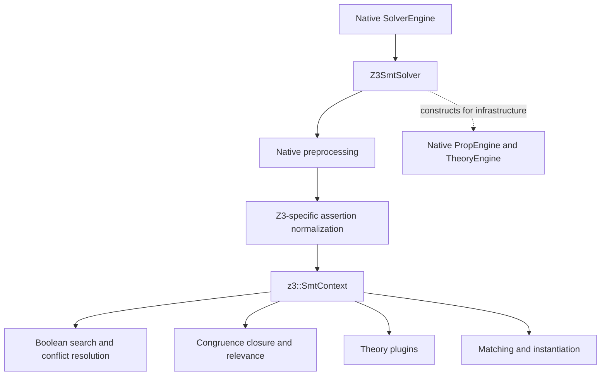
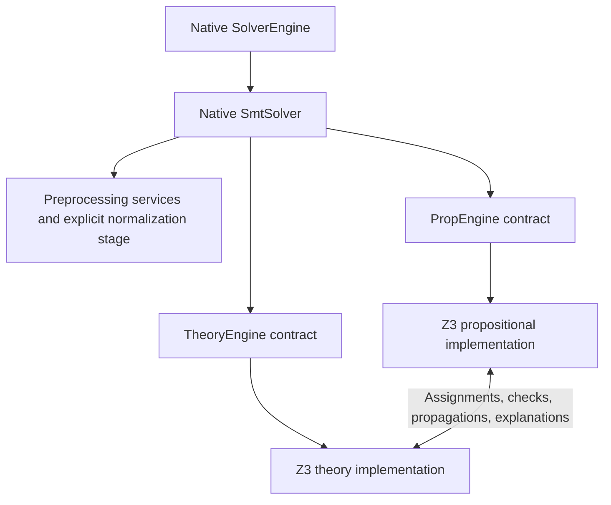

# Proposal: progressively align the Z3 port with cvc5's architecture

Date: 2026-10-10

Source snapshot: `da001fa639` (`Preset`)

Status: Stages 1A and 1B implemented. See the progress record in section
14.

## 1. Objective and migration principle

The experiment began by reproducing a large portion of Z3's SMT core inside
cvc5 to investigate quantifier performance. The next objective is to retain
the useful performance while progressively returning control to cvc5's native
architecture.

The primary measure of progress should be the highest architectural layer
still replaced by Z3-specific machinery. Removing an alternative SMT driver
is an earlier milestone than replacing an individual arithmetic algorithm,
even if the latter would delete more source lines.

The governing rule is:

> Above the current replacement boundary, ordinary cvc5 code runs through
> ordinary cvc5 contracts. Backend selection is confined to construction and
> configuration. Z3-specific state and control flow stay below that boundary.

Apply this rule recursively. First restore native SMT orchestration over Z3
propositional and theory implementations. Then restore native propositional
and theory orchestration over smaller Z3 components. Continue until the
remaining imported mechanisms are localized algorithms or data structures
with a measured reason to remain.

Architectural alignment does not require deleting every algorithm that
originated in Z3. A useful matching algorithm inside cvc5's quantifier
architecture can be a successful endpoint. Retaining an alternate top-level
solver because that algorithm needs it is the dependency to eliminate.

Source size remains useful, but is a secondary measure. Early interface work
can increase the diff while reducing the scope of the architectural fork.

## 2. Current architecture

The relevant implementation is described in [README.md](README.md) and
[FIDELITY.md](FIDELITY.md). Those documents contain historical measurements
from different configurations and benchmark samples; this proposal does not
treat them as one reproducible performance baseline.

The current search path is:

In [SolverEngine::finishInit](../smt/solver_engine.cpp), the `--z3` option
replaces the previously constructed `SmtSolver` with `Z3SmtSolver`. The
replacement also causes the SyGuS and quantifier-elimination solver wrappers
to be reconstructed around the new SMT solver.

[Z3SmtSolver](../smt/z3_smt_solver.h) overrides initialization, assertion
delivery, satisfiability checking, push/pop, trail reset, interruption, and
assertion reset. Its initialization still calls the native
`SmtSolver::finishInit`, constructing native propositional and theory engines
for infrastructure. Actual search runs in a separate `z3::SmtContext`.

This produces two architectural problems:

- SMT orchestration has an alternative implementation, so changes to native
  orchestration can bypass the experiment or need a separate implementation.
- Existing engine accessors expose native engine objects even though the
  active search state belongs to the port. Each consumer must be understood
  before those accessors can serve as a reliable abstraction boundary.

The port already uses cvc5 `Node`, rewriting, and preprocessing. The task is
therefore to restore ownership and communication boundaries around search,
not to replace the term representation again.

## 3. The first milestone

The first target is a single native `SmtSolver`, using selectable
propositional and theory engine implementations:

`Z3PropEngine` and `Z3TheoryEngine` are descriptive names for the proposed
implementations. They do not yet exist, and this diagram does not prescribe
inheritance or final filenames.

The first milestone has two distinct stages.

### Stage 1A: restore native SMT orchestration

Remove `Z3SmtSolver` and run both configurations through native `SmtSolver`.
Introduce the engine contracts needed by its callers, with Z3 implementations
that may initially delegate to one shared `SmtContext`.

This is meaningful progress if native `SmtSolver` actually performs the
bookkeeping and lifecycle operations, and supported queries go to the active
backend. Moving the existing alternate driver wholesale behind one generic
`runZ3` method would not achieve that.

A shared backend is an explicitly temporary implementation technique. It
allows the surrounding architecture to change while preserving the existing
search loop, callback order, and data structures. Stage 1A does not establish
that the propositional and theory implementations can be exchanged
independently.

### Stage 1B: establish the propositional/theory boundary

Separate the responsibilities currently combined in `SmtContext`. Route the
interactions needed by search through explicit contracts, and give mutable
state a clear owner.

This completes the first architectural milestone. The criterion is that a
subsequent replacement of either implementation has a defined interface to
implement, without reaching through the other implementation to arbitrary
`SmtContext` internals. Independent replacement may still require additional
capabilities; those must be recorded rather than hidden behind a shared
context pointer.

Behavior preservation should guide both stages. Replacing arithmetic,
changing matching policy, or retuning heuristics belongs in later work unless
a specific interface defect makes a small prerequisite change necessary.

## 4. Responsibilities at the restored SMT boundary

The native [SmtSolver](../smt/smt_solver.cpp) already delegates search to
`PropEngine::checkSat` and assertions to `PropEngine::assertInputFormulas`.
The migration should reuse that orchestration while supplying suitable engine
implementations.

| Responsibility | Intended owner after Stage 1A | Requirement |
|---|---|---|
| Backend construction | Engine construction/configuration code | Select a compatible pair of engines; keep selection out of ordinary SMT operations. |
| Assertion management | Native `SmtSolver` and `Assertions` | Preserve assertion tracking, skolem metadata, and preprocessing soundness information. |
| Input transformation | Preprocessing services plus an explicit backend preparation stage | Preserve the formula and ordering currently received by the port. |
| Search | Propositional engine contract | Run the selected search implementation and return its result. |
| Theory status | Theory engine contract | Report incompleteness and soundness information from the active backend. |
| Push/pop and trail reset | Native orchestration invoking engine lifecycle contracts | Distinguish user scopes from search scopes; reset shared state once. |
| Interruption and resource limits | Common lifecycle contract with backend implementation | Interrupt the active search and preserve the reason for termination. |
| Value and state queries | Active engine contracts | Never use inactive native search state as a substitute. |
| Optional services | Explicitly supported backend capabilities | Architectural integration alone does not add model, proof, or other feature support. |

The current `Z3SmtSolver::checkSatInternal` translates Z3 search outcomes into
cvc5 `Result` values and unknown explanations. That translation belongs behind
the engine contract. Native `SmtSolver` should not need to understand Z3
failure enums.

Reusing native orchestration also exposes behavior that the override currently
bypasses. For example, native assertion delivery forwards preprocessing
soundness flags and maintains assertion/skolem bookkeeping. These obligations
must be checked explicitly; merely reaching the native methods does not show
that the backend consumes the information correctly.

## 5. Interface design and implementation approach

### Start from callers and existing contracts

[PropEngine](../prop/prop_engine.h) and
[TheoryEngine](../theory/theory_engine.h) are concrete classes with largely
non-virtual public operations. Adding subclasses alone would not redirect
calls made through the existing pointer types.

There are two plausible implementation approaches:

- Extract shared interfaces and have the existing native classes and new Z3
  classes implement them.
- Keep stable engine facades and delegate appropriate operations to a backend
  owned by each facade.

Prefer the smallest interface change that preserves native ownership and
serves actual callers. The initial dependency audit should determine which
approach causes less disruption. Do not duplicate the entire large engine API
before identifying which portions are search operations, preprocessing
services, and optional facilities.

The audit must include more than `SmtSolver`. Relevant consumers include
`SolverEngine`, `Preprocessor`, `PreprocessingPassContext`, and `Valuation`.
They currently store or retrieve concrete engine pointers. A method that is
only called during initialization can still prevent a clean substitution.

### Construct a compatible backend pair

During Stage 1A, construct the two Z3 engine views together with one explicit
owner of the shared backend. Keep ownership and destruction order local to
that implementation. `SmtSolver` can own generic engine interfaces without
owning a `z3::SmtContext` or a Z3 parameter object directly.

Do not expose arbitrary combinations of native and Z3 engines before their
contracts are compatible. A coupled Z3 pair is a valid intermediate state;
claiming independent interchangeability at that point would overstate the
result.

Avoid a generic interface that returns `SmtContext*` so callers can bypass
missing methods. Use explicit operations and record any temporary dependency
that remains below the boundary.

### Separate infrastructure from active search state

Native preprocessing currently depends on services supplied by native engine
objects. Those services need either independent ownership or deliberate
delegation through the new facades.

It is acceptable to retain a native service object for preprocessing while
performing Stage 1A. Its purpose and lifetime must be explicit. It must not
answer active valuation, assertion-level, model, or search-status queries.
The engine accessor contract must identify the active implementation for every
supported query.

## 6. Preserve preprocessing and lifecycle semantics

### Assertion preparation

`Z3SmtSolver::assertToInternal` currently performs additional work after
native preprocessing: NNF and quantifier naming, connective and bound-variable
normalization, optional rewriting and ITE lifting, and pattern inference.
Definitions introduced by quantifier naming are delivered before the formula
that caused them. Further normalization occurs when instances are
internalized.

Move this behavior into an explicit preparation stage, initially retaining
its exact transformations and order. A backend preparation hook is a possible
first implementation; integration as native preprocessing passes can follow
once the contracts are established.

There is an important placement constraint. Native `SmtSolver::preprocess`
documents an invariant about assertion ordering and introduction of new
assertions at its boundary, whereas the port's preparation can add
definitions. The implementation must account for assertion indices, the
skolem map, and the distinction between original assertions and generated
definitions. Moving the code to a different method without updating these
contracts is insufficient.

Preserve the existing treatment of Boolean terms and term ITEs while doing
this work. Trigger availability depends on these shapes. Do not accidentally
run two internalizers or apply native CNF conversion and the port's conversion
to the same assertion.

### Initialization and reset

Native `SmtSolver::resetAssertions` recreates its propositional engine while
retaining its theory engine. The port currently recreates `SmtContext`.
A pair of facades sharing that context therefore needs a coordinated reset
contract; neither facade may retain references to the old state.

Preserve the lifetime relationship between `Params` and `SmtContext`, and
audit initialization order. The existing fidelity notes document at least
one parameter whose effective value depends on when it is copied during
construction. Structural changes can alter search settings without changing
an option's declared default.

Distinguish the following operations in the lifecycle design:

- User push/pop of assertions.
- SAT decision-level push/backtrack during search.
- Restarts and resetting the search trail to the current assertion level.
- Repeated satisfiability checks, including assumptions where supported.
- Resetting all assertions and destroying/recreating backend state.

Each state structure needs one owner and one rollback policy. Delayed theory
scopes, instance caches, normalization caches, relevance state, and queued
propagations must be included in that accounting.

Presolve, postsolve, cancellation, and statistics registration must likewise
occur once at the appropriate layer. Native `PropEngine::checkSat` performs
lifecycle work beyond calling a SAT solver; wrapping it around an existing
complete search driver without reviewing those calls can duplicate work.

## 7. Establishing the propositional/theory boundary

The central difficulty in Stage 1B is that `SmtContext` combines Boolean
search, internalization, congruence closure, relevance, theory dispatch, and
quantifier scheduling. These responsibilities do not divide into two files
along cvc5's current boundary.

Use [TheoryProxy](../prop/theory_proxy.h) as an existing contract reference:
it already describes theory checks, literal delivery, propagation,
explanations, decision requests, restarts, and incompleteness. It is not
automatically a ready-made interface for the port; its concrete dependencies
and scheduling assumptions must be examined.

The split should account for these interactions:

| Interaction | Contract to establish |
|---|---|
| Term and atom registration | Which side creates Boolean literals and theory terms, and when registration can produce further work. |
| Assigned theory literals | Which assignments are delivered, in what order, and at what search scope. |
| Equality and disequality information | Who owns congruence closure and how interested theories and matching receive notifications. |
| Propagations | How new facts return to Boolean search, including their explanation and lifetime. |
| Conflicts and lemmas | How theory reasons become clauses and how auxiliary terms are registered. |
| Check scheduling | When propagation, theory checking, quantifier work, and final checking run and reach a fixed point. |
| Relevance and decisions | How relevance changes and requested case splits cross the boundary. |
| Backtracking and restarts | Which callbacks restore which state and invalidate which pending work. |
| Final status | How consistency, incompleteness, and model soundness determine the public result. |

Congruence closure naturally belongs with theory services in the target
decomposition, while Boolean assignments and conflict search belong with the
propositional implementation. Relevance and internalization require a more
careful allocation because both sides consume their effects. Their ownership
should be decided from dependencies, not from filenames.

Keep `ENode`, clause, and justification representations private below the
restored SMT boundary. At the prop/theory boundary, isolate any representations
that must initially be shared and document them as remaining dependencies.
Converting every low-level structure in the same change would make it harder
to identify the source of a regression.

## 8. Proposed implementation sequence

The first implementation effort should be a sequence of reviewable changes
with a stable reference executable throughout.

| Step | Deliverable | Completion evidence |
|---|---|---|
| 0. Record the baseline and contracts | Exact source/build/configuration/benchmark manifest; inventory of engine callers and current capabilities | Reference runs can be reproduced; each required operation has an identified owner. |
| 1. Introduce the chosen engine abstraction | Native implementations behind the selected interfaces or facades | The ordinary cvc5 configuration preserves behavior and performance. |
| 2. Extract assertion preparation | Explicit port-specific preparation stage with metadata handling | The formulas and order delivered to the port agree with the reference. |
| 3. Add the coupled Z3 engine pair | Shared backend encapsulated behind prop/theory contracts | The native SMT driver performs checking, scope operations, and supported queries through the new implementations. |
| 4. Remove `Z3SmtSolver` | Delete the alternate driver and its selection/reconstruction path | Stage 1A acceptance criteria pass; the shared backend remains documented. |
| 5. Separate prop/theory responsibilities | Explicit event, state ownership, and explanation contracts | Stage 1B acceptance criteria pass; remaining cross-component dependencies are enumerated. |

Steps may be combined when that makes a patch easier to understand. Keep
changes to search algorithms and heuristic defaults separate from these
structural changes. If restoring a native path reveals a correctness defect,
isolate its correction and explain its effect on the comparison rather than
preserving the defect to obtain identical traces.

## 9. Expected code changes and deletion accounting

The initial work mostly reorganizes the existing experiment. It does not
require importing another Z3 subsystem or replacing an individual theory.

| Area | Expected change |
|---|---|
| `src/smt/solver_engine.cpp` | Remove the alternative SMT-solver construction path; retain one native driver. |
| `src/smt/smt_solver.{h,cpp}` | Construct/select engine implementations through a common mechanism and retain native orchestration. |
| `src/smt/z3_smt_solver.{h,cpp}` | Delete after moving necessary preparation and backend behavior to their proper owners. |
| `src/prop/prop_engine.{h,cpp}` and `src/theory/theory_engine.{h,cpp}` | Establish engine contracts or backend delegation with a working native implementation. |
| New Z3 prop/theory integration files | Implement the selected contracts and initially encapsulate the shared context. |
| `src/smt/preprocessor.*` and `src/preprocessing/preprocessing_pass_context.*` | Adapt engine dependencies and host explicit preparation where appropriate. |
| `src/theory/valuation.*` and other engine consumers | Ensure state queries use active engine contracts; exact edits depend on the interface approach. |
| `src/prop/theory_proxy.*` and `src/z3/smt_context.*` | Establish the internal prop/theory interaction during Stage 1B. |
| `src/CMakeLists.txt`, options, and experimental documentation | Update sources, backend construction/configuration, and the documented architecture. |

At the source snapshot recorded above:

- `z3_smt_solver.h` contains 73 lines and `z3_smt_solver.cpp` contains 163:
  236 lines in the wrapper proposed for removal.
- `src/z3` contains 96 C++ source/header/include-fragment files and 42,417
  physical lines, including comments, blank lines, and original adapter code.

The 236 wrapper lines are a gross removal figure, not an expected net saving.
Necessary behavior moves into other components, and interfaces add code.
Stage 1A may have a positive net diff. No substantial deletion of the
42,417-line implementation should be credited merely because it becomes
private to new facades or moves to another directory.

Keep separate counts for imported code removed, code moved, new integration
code, and native code modified. Preserve provenance notices on retained or
moved imported implementations. Detailed estimates for later component
deletions should follow the architecture split, when their dependency closure
can be measured accurately.

## 10. Acceptance criteria and measurement

### Architectural acceptance

Stage 1A is complete when:

1. There is one native `SmtSolver` implementation in the active paths, with no
   `Z3SmtSolver` subclass or equivalent alternate driver.
2. Backend-specific selection is localized to construction/configuration;
   normal SMT operations do not branch on Z3-specific search behavior.
3. Assertion bookkeeping, result handling, and lifecycle dispatch use the
   native orchestration and explicit engine contracts.
4. Supported engine queries return information from the active backend.
   Unsupported facilities have an explicit capability boundary, rather than
   silently querying inactive native state.
5. Shared backend ownership and any retained preprocessing-only services are
   documented, with coordinated initialization and reset.

Stage 1B additionally requires identifiable owners for Boolean and theory
state, explicit interactions between them, and no unrestricted shared-context
access that bypasses the intended boundary. Any remaining representation or
scheduling dependency is listed as work for the next level.

### Correctness and lifecycle validation

Compare the reference and candidate on the supported input/configuration
scope. Exercise single checks, repeated checks, user push/pop, assertion
reset, interruption, resource exhaustion, and assumptions where supported.
Include cases that require theory propagation, nested quantifier
instantiation, and rollback after generated lemmas.

Verify the public result and relevant unknown/incompleteness reason. A backend
that currently cannot confirm quantified satisfiability must not start
returning `sat` because its incompleteness information was lost in an adapter.
Likewise, forwarding through native interfaces does not establish support for
proofs, models, unsat cores, SyGuS, or quantifier elimination. Existing
capabilities and limitations need an explicit inventory.

Run relevant native regressions as well, because introducing engine
abstractions affects the ordinary configuration. Cross-solver agreement is
useful regression evidence, but does not by itself prove soundness.

### Performance validation

Freeze a benchmark manifest, compiler/build settings, machine conditions,
timeouts, seeds, and the complete option set. Use the pre-change port as the
primary control for architectural refactoring. Keep native cvc5 with
`--user-pat=strict --no-cbqi` and appropriately configured Z3 as contextual
references. Treat `verus` and `verus-best` as separate configurations.

Track per-benchmark outcomes, common-solved runtimes, memory, timeouts, and
important search counters. Interleave reference/candidate runs and repeat
borderline or noisy cases. Maintain a held-out set and expand beyond the
small diagnostic sample before declaring a milestone complete.

For a structural change, expect search counters and normalized inputs to
remain close, and often identical on deterministic cases. Investigate
differences using the existing assertion, instance, and event diagnostics.
Exact trace equality is a diagnostic aid, not a requirement for every future
architectural substitution.

A completed step should have no unresolved answer changes or material
performance regressions beyond the measured run-to-run variation. Record
individual losses as well as aggregate gains. If there is an intentional
tradeoff, report it explicitly rather than counting the architectural step as
performance-preserving.

## 11. Main risks and how to contain them

| Risk | Consequence | Containment |
|---|---|---|
| Facades preserve hidden SMT orchestration | The class disappears but the high-level fork remains | Review responsibility ownership, not just class names and includes. |
| Queries reach an inactive native engine | Incorrect assignments, assertion levels, or status information | Audit all engine consumers and test active-state queries. |
| Shared context reset or rollback happens twice | Stale references or inconsistent scopes | One backend owner and explicit lifecycle coordination. |
| Preprocessing or registration order changes | Different terms, literals, relevance, and trigger availability | Compare prepared assertions and registration/event traces. |
| Theory information is delivered later | Matching misses productive search states or explores more branches | Preserve callback scheduling before replacing algorithms. |
| Explanations outlive their scope | Invalid propagated facts or conflicts | Specify reason ownership and rollback semantics at the interface. |
| Initialization timing changes effective parameters | Performance changes despite identical options | Record effective configuration and preserve initialization order. |
| Interface abstraction is too broad or costly | Large native churn or hot-path overhead | Separate cold orchestration from hot callbacks; measure native and port configurations. |
| A local metric hides remaining coupling | Apparent progress without an independently replaceable component | Report the highest replacement layer and remaining dependencies for each branch of the architecture. |

## 12. Continuing recursively

After the first milestone, proceed down the two branches of the architecture.
The hierarchy supplies the ordering constraint; it does not force an arbitrary
order between sibling components.

| Architectural level | Replacement to retire | Possible lower-level remainder |
|---|---|---|
| SMT orchestration | `Z3SmtSolver` | Z3 prop/theory engine implementations |
| Propositional orchestration | Z3 prop-engine implementation | Z3 SAT/search, decision, or internalization components behind native orchestration |
| Theory orchestration | Z3 theory-engine implementation | Individual theory, equality, and quantifier implementations |
| Individual solver modules | Z3-specific theory or quantifier module | Local algorithms and data structures with measured value |
| Local mechanisms | Remaining duplication where native alternatives suffice | Small, justified residual implementation |

The existing [SAT solver interfaces](../prop/sat_solver.h) provide a candidate
boundary for the propositional branch. Using them will also require resolving
CNF/internalization, relevance, and theory-callback assumptions; the whole
current `SmtContext` is not automatically a SAT solver implementation.

For the theory branch, restoring native `TheoryEngine` would make individual
ported theories and quantifier components the next explicit dependencies.
Replacing arithmetic can then be evaluated at the restored theory interface,
as one child of the architecture, rather than becoming the organizing goal of
the migration.

Maintain a progress record with the highest remaining replacement on each
branch, the native layers restored, the dependencies that still cross the
intended boundaries, the source accounting, and the performance comparison.
Two branches can be at different depths; a single line count or stage number
would obscure that information.

## 13. Decisions for the first implementation

The proposed direction is to restore native `SmtSolver` over
engine contracts, then separate the port's prop/theory responsibilities.
Several implementation choices remain to be resolved by a focused audit:

- Whether shared interfaces or stable facades minimize changes to native
  callers while keeping responsibilities clear.
- Which native engine services preprocessing requires independently of active
  search, and how to provide them without exposing inactive search state.
- Where backend assertion preparation belongs and how generated definitions
  and skolem metadata are represented at that boundary.
- How a coupled backend is owned and reset while native orchestration remains
  common to both configurations.
- Which exact operations and optional capabilities must be supported to
  preserve the current experimental scope.

The concrete next implementation deliverable is Stage 1A: a native
`SmtSolver` running the existing port through explicit prop/theory engine
contracts, with a reproducible behavior and performance comparison. The
shared `SmtContext` at that stage should be visible in the design and progress
record. Stage 1B then turns that integration boundary into an internal
architectural separation suitable for the next recursive replacements.

## 14. Progress record

### Stage 1A: done

Implemented in `8a1ca4ad2c`, followed by the capability changes described
below.

| Branch | Highest Z3-specific layer remaining | Notes |
|---|---|---|
| SMT orchestration | none | `Z3SmtSolver` is deleted; native `SmtSolver` drives both configurations. |
| Propositional | `z3::Z3PropEngine`, a whole engine | Implements `PropEngine`'s search contract over the shared `SmtContext`. |
| Theory | `z3::Z3TheoryEngine`, a whole engine | Owns the shared backend. Its inherited `TheoryEngine` serves preprocessing only. |

Native layers restored:

- `SmtSolver` performs assertion bookkeeping, forwards preprocessing
  soundness flags, constructs the engines and dispatches the lifecycle for
  both configurations. `smt_solver.h` is identical to master.
- `SolverEngine` contains no reference to `--z3`. Commands that need an
  optional feature ask the engine through `PropEngine::supports`.
- Backend selection happens only in construction (`smt::EngineFactory`) and
  configuration (`SetDefaults::checkZ3Capabilities`).

Contracts introduced:

- The search contract of `PropEngine`, whose methods are now virtual:
  `finishInit`, `assertInputFormulas`, `checkSat`, `push`, `pop`,
  `resetTrail`, `getAssertionLevel`, `interrupt` and `supports`. None of
  these is called on the hot path of the search.
- `prop::SearchFeature`, the capability query for user scopes, assumptions,
  and participation of cvc5's quantifiers engine.
- A virtual destructor on `TheoryEngine`.

Dependencies that still cross the intended boundaries:

- `Z3PropEngine` and `Z3TheoryEngine` share one `SmtContext` through
  `z3::SharedBackend`, which `Z3TheoryEngine` owns. `EngineFactory` pairs the
  two engines with a cast that is checked only in debug builds.
- `Z3PropEngine` reads the preprocessing soundness flags from its paired
  theory engine.
- Both Z3 engines inherit the native engines. The inherited SAT solver, CNF
  stream and theories are constructed but inactive. Their non-contract
  queries can only be reached through refused features: options are refused
  in `checkZ3Capabilities`, and commands through `supports`.
- Assertion preparation (`z3::AssertionPreparation`) runs inside
  `Z3PropEngine::assertInputFormulas`. It uses utilities owned by the
  `SmtContext`, because instance internalization uses the same utilities.
- The translation of unknown reasons is preserved from the old driver, so a
  time limit is reported as `INTERRUPTED` rather than `TIMEOUT`.

Behavior changes, all intended:

- The preprocessing soundness flags now take effect. Only `int-to-bv` and
  `solve-real-as-int` set them.
- The exception paths in `SmtDriver` now reset the trail of the active
  search. Previously they reset the trail of the inactive native engine.
- The following are now refused, because each one read inactive native
  state: `--deep-restart`, `--dump-instantiations`, which previously printed
  "none" after the port had instantiated, `--oracles`, `declare-pool`, and
  the API's instantiation queries.
- The messages for refused commands changed from "not supported with --z3"
  to "not supported by the selected search engine".

Source accounting, in physical lines of C++ files under `src/z3`:

- At `da001fa639`: 96 files, 42,417 lines. Immediately before Stage 1A
  (`75c37b9f3b`): 96 files, 42,144 lines.
- After Stage 1A: 104 files, 42,732 lines. The imported implementation is
  unchanged; the difference is 588 lines of new integration code in
  `z3_prop_engine`, `z3_theory_engine`, `shared_backend` and
  `assertion_preparation`.
- Removed: `src/smt/z3_smt_solver.{h,cpp}`, 236 lines. Its assertion
  preparation and result translation, about 85 lines, moved into the new
  files.
- Added outside `src/z3`: `src/smt/engine_factory.{h,cpp}`, 105 lines.
- Native code modified: `prop_engine.{h,cpp}`, `theory_engine.h`,
  `smt_solver.{h,cpp}` (restored to master apart from engine construction),
  `solver_engine.{h,cpp}` and `set_defaults.cpp`, roughly 110 lines added and
  60 removed.

Performance and behavior:

- Local comparison against the build from before the change: 444 quantified
  regressions, each run under the default and `verus-best` presets with a
  10 s limit. In 873 of the 888 runs the answers and every `z3::` search
  counter were identical; the other 15 timed out in both builds. Runs
  limited by `--rlimit` stopped at the same point with identical counters.
- The benchmark comparison on the reference set showed no regression.

### Stage 1B: done

The audit of `SmtContext` that section 7 calls for is recorded in
[PROP_THEORY_SPLIT.md](PROP_THEORY_SPLIT.md). It allocates relevancy to the
propositional side, splits internalization as cvc5 splits CNF conversion from
pre-registration, and proposes seven extraction steps that preserve
behavior. All seven are done, each checked as in Stage 1A (identical
answers and `z3::` counters on the local comparison set, with runs that
time out compared under `--rlimit`):

1. Dead paths removed: 239 lines of imported code that nothing reached,
   listed in FIDELITY.md.
2. `z3::Explainer` extracted from `ConflictResolution`. The first-UIP
   resolution no longer reads the E-graph.
3. `z3::TheoryStatus` extracted. It holds the unsupported and model-unsound
   records that decide whether "sat" can be confirmed.
4. (a) `z3::PropCore` extracted: the Boolean search state and the methods on
   it, about 1,500 lines moved unchanged out of `smt_context.cpp` and
   `internalizer.cpp`. The search driver, conflict resolution and the
   sequencing of scopes remain in `SmtContext` until step 4(b). On a small
   timing sample with identical work, the run time was unchanged (ratio
   0.996).

   (b) The search driver moved into `PropCore` as well: search, restarts,
   decisions, the propagation fixpoint, conflict resolution and the push
   and pop of scopes. `SmtContext` is now the theory side. Apart from its
   entry points (`check`, `push`, `pop`, the input queue), the driver
   reaches it only through the scheduling and backtracking contract listed
   in `PropCore`'s class comment and in PROP_THEORY_SPLIT.md. Answers and
   `z3::` counters are unchanged, and runs that time out match under
   `--rlimit`. On the same small timing sample the ratio was 0.951, which is
   within the noise.
5. Relevancy is owned by `PropCore`. The theory side keeps only the part of
   the relevancy notification that reaches the quantifier manager and the
   theories, and gives the propagator the members of an equivalence class.
6. Internalization is split as cvc5 splits CNF conversion from
   pre-registration. `PropCore` encodes gates and root assertions. The
   theory side walks the input, makes enodes and theory atoms, and calls it
   at the same points as before. Theory plugins register an atom with one
   call.
7. Ownership is wired. `Z3PropEngine` drives `PropCore`, which now also
   holds the entry points (check, user scopes) and the asserted formulas.
   `SmtContext` has no entry points and is driven only through its contract
   with `PropCore`. The two are still allocated together, inside
   `SharedBackend`.

Every step left answers and `z3::` counters unchanged on the comparison
set, and runs that time out were compared under `--rlimit`. On the
benchmark set, performance was unchanged after each step that was
measured.

| Branch | Highest Z3-specific layer remaining | Notes |
|---|---|---|
| SMT orchestration | none | Native `SmtSolver` for both configurations. |
| Propositional | `z3::Z3PropEngine` over `z3::PropCore` | `PropCore` holds Z3's Boolean search: variables, clauses, BCP, conflict resolution, decisions, restarts, relevancy, the encoding of gates, and the search driver. |
| Theory | `z3::Z3TheoryEngine` over `z3::SmtContext` | `SmtContext` holds Z3's theory reasoning: the E-graph, the theory plugins, quantifiers and E-matching, the internalizing walk, the explainer and the theory status. |

Dependencies that still cross the boundary, as work for the next level:

1. **Allocation.** `PropCore` lives inside `SmtContext`, so that the
   theory side's Boolean queries (`getAssignment`, `isRelevant` and others,
   called on the hot paths of E-matching and the theories) are inline
   forwarders. Replacing either side independently requires turning that
   Boolean API into an interface, at the cost of an indirection.
2. **Propositional components still hold the theory-side handle.**
   `ConflictResolution` and `CaseSplitQueue` take `SmtContext&` and make
   their Boolean queries through its forwarders. `ConflictResolution` also
   calls `Theory::conflictResolutionEh`, and the case split queue can ask
   `isExtDiseq` (off by default). Both could take `PropCore&` instead.
3. **Shared infrastructure on the theory side.** The trail stack, the
   region, the statistics, the random number generator and the store of
   justifications belong to `SmtContext` and are used by both sides. The
   trail is one LIFO log for both, as `context::Context` is in cvc5.
4. **Variable data.** `BoolVarData` holds the Boolean data together with
   the theory side's atom-kind flags (enode, equality, quantifier,
   theory-notified). `PropCore` reads them to decide which assignments to
   hand over and which to requeue when they become relevant.
5. **The variable map.** The map between Boolean variables and Nodes is
   `PropCore`'s, but the theory side uses it throughout: the internalizer,
   the theories and E-matching.
6. **The internalizing walk.** The walk decides what is a gate and what is
   an atom, and stays on the theory side. `assertRoot` calls back into it for
   the arguments of a root gate.
7. **Clauses from the theory side during the search.** Instances, theory
   axioms, dynamic Ackermann lemmas and E-graph propagations reach
   `PropCore`'s clause API with region-allocated justifications.
   `PropCore` explains these through the theory side's `Explainer`.
8. **Generations across backjumps.** The generations of enodes and
   quantifiers are cached by the theory side when `PropCore` backjumps, and
   restored when it recreates atoms.
9. **Relevancy and equivalence classes.** The relevancy propagator reads the
   theory side's equivalence classes, and `relevantEh` is split between the
   two sides.
10. **Theory plugins.** Plugins register atoms with `mkTheoryAtomVar`, but
    still read and assign the Boolean state through the forwarders, as
    cvc5's theories do through `Valuation` and the output channel.
11. **Defects.** The defects listed in PROP_THEORY_SPLIT.md, section 9, are
    not fixed; each is to be fixed in a change of its own.

The next level is the recursion of section 12, on the two branches:

- The propositional branch can now be addressed at `PropCore`, for example
  behind cvc5's SAT solver interfaces.
- The theory branch can be addressed at `SmtContext`, toward native
  `TheoryEngine` with ported theories.

With the boundary in place, a component on either side can be replaced on
its own, and the effect on performance attributed to it.
